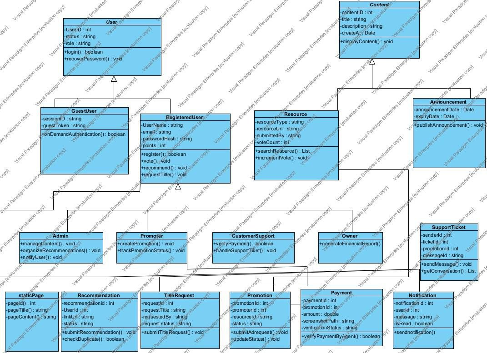

# Wachemo University 
## Department of Software Engineering

## Acknowledgement

First and foremost, we give thanks to God for granting us the strength, patience, and wisdom to undertake and complete this project. We would also like to express our sincere gratitude to our Web Programming course instructor for assigning this project and providing the academic guidance necessary to carry it out. Finally, we recognize the dedicated collaboration, effort, and commitment of all six team members who worked together throughout every stage of the system's planning, design, and development.

## Table of Contents

## Executive Summary

RightGuide is a community-driven web platform built with pure HTML, CSS, JavaScript, PHP, and MySQL that helps learners discover reliable websites and YouTube channels for learning specific programming languages—starting with more than five core languages—through peer recommendations and community voting. Instead of struggling with scattered search results and unverified links, users simply select a target programming language to view curated free and paid learning sources ranked by community feedback. To encourage active participation and trustworthy curation, registered contributors earn reward points for approved recommendations—unlocking promotional placements upon reaching a 20-point threshold—while promoters can submit paid promotion requests verified manually by support agents, and administrators moderate submissions to prevent duplicates and maintain content quality.

## Chapter One: Introduction
### 1.1 Understanding the Problem Background and Knowing the Exact Problem
#### 1.1.1. Background of the Problem

Learning a programming language requires dependable tutorials, structured documentation, and clear video instruction. While thousands of educational websites and YouTube channels exist online, beginners and self-learners often struggle to identify trustworthy, up-to-date learning materials amid an overwhelming volume of unverified search results.

#### 1.1.2. The Real Environment

Currently, students and self-learners discover programming resources through general search engines, standalone YouTube searches, or informal recommendations shared in peer chat groups. In this fragmented environment, learners must manually open and evaluate dozens of links without knowing whether a source is beginner-friendly, free or paid, or preferred by experienced peers, while quality content creators lack a dedicated channel to gain visibility for helpful educational resources.

#### 1.1.3. Root Causes of the Problem

The difficulty in finding reliable programming learning resources stems from four primary causes:

- Fragmented Resource Distribution: Quality websites and instructional YouTube channels are spread across disconnected platforms with no centralized directory organized by programming language.
- Absence of Community Validation: General search rankings prioritize popularity or search optimization rather than verified learner feedback, making it hard to judge educational quality or discover better alternatives.
- Lack of Cost and Format Clarity: Links shared across search results and social groups rarely indicate upfront whether a resource is free, paid, or structured for beginners.
- Unstructured and Duplicate Sharing: Recommendations exchanged in informal forums or messaging groups are unmoderated, frequently duplicated, and quickly buried.

#### 1.1.4. Impact on Target Users

These limitations directly affect key participants in the programming learning ecosystem:

- Students and Beginners: Waste study time browsing low-quality or outdated tutorials and struggle to find a clear starting point for a chosen programming language.
- Self-Learners: Face decision fatigue comparing scattered websites and YouTube channels without peer ratings or transparent free-versus-paid labels.
- Content Creators and Educators: Struggle to reach learners actively studying a specific programming language without relying on paid advertising algorithms.

#### 1.1.5. The Exact Problem

The exact problem this project addresses is the absence of a centralized, community-validated web directory where learners can select a specific programming language—starting with more than five core languages—and immediately discover trustworthy, peer-ranked websites and YouTube channels. RightGuide solves this problem by combining language-specific resource categorization, duplicate-checked user submissions, community voting, and administrator moderation in a single platform.

### 1.2. Objectives of the project
#### 1.2.1. General objective

To design and develop RightGuide, a web-based, community-driven programming resource discovery platform built with pure HTML, CSS, JavaScript, PHP, and MySQL that enables learners to select from more than five programming languages and discover peer-recommended websites and YouTube channels, supported by on-demand guest authentication (guestToken), duplicate-checked submissions, a creator point-reward system, and a manual payment-verification workflow for promotions.

#### 1.2.2. Specific objectives

- To Implement Role-Based Authentication & On-Demand Guest Access: Develop a secure access-control system supporting public registration for registered users/content creators and promoters, pre-configured staff logins for administrators, customer support agents, and the system owner, and automatic on-demand guestToken assignment for anonymous visitors.
- To Build Language-Based Discovery & Duplicate-Checked Search: Enable learners to select from five core programming languages to browse curated websites and YouTube channels, supported by keyword and URL lookup that detects duplicate links and prompts users to vote on existing entries rather than creating redundant submissions.
- To Establish Community Voting & Referral/Creator Point Rewards: Implement a one-vote-per-user/token voting mechanism alongside a point system where registered users earn reward points from administrator-approved referrals (with guest referrals excluded and internal notifications sent upon approval) and verified resource submissions—unlocking free promotional placements upon reaching the 20-point threshold.
- To Enable New Language & Topic Requests: Provide a structured request workflow allowing users to suggest additional programming languages or learning topics beyond the initial five core languages for administrative review and platform expansion.
- To Support Transparent Bank-Transfer Promotion & Manual Verification: Build a promotion submission workflow where users request placements, submit bank transfer payment proof (such as a screenshot) or redeem earned points, and track real-time statuses, backed by a manual verification interface for customer support agents.
- To Deliver Internal Notifications & Asynchronous Support: Implement an automated internal notification system that alerts users and promoters of account, referral, recommendation, and payment status updates, paired with a structured support ticket workflow for user inquiries.
- To Provide Content Moderation, Announcements & Owner Analytics: Create an administrative dashboard to review submissions, group identical URLs with combined recommendation counts, verify free-versus-paid source rules, publish platform-wide popup announcements, and enable the system owner to generate platform performance and financial reports.

### 1.3. Methodologies
#### 1.3.1. Requirement Elicitation Methodology

To define and deliver RightGuide within a strict 60-day academic timeline, a lightweight, user-centric requirement elicitation methodology is employed using four complementary techniques:

- Document & Constraint Analysis: Reviewing project guidelines and technical boundaries—specifically the vanilla web stack (HTML, CSS, JavaScript, PHP, MySQL), manual bank-transfer payment verification, manual referral review, and internal notifications—to establish clear system constraints.
- Stakeholder & Role Profiling: Analyzing the needs and access boundaries of all six system actors (Unregistered Guests, Registered Users/Creators, Promoters, Customer Support Agents, Administrators, and the System Owner) to map out precise permissions and dashboard views.
- Workflow & Rule Modeling: Translating core user journeys—such as selecting from five core programming languages, on-demand guest tokenization (guestToken), duplicate URL detection, and manual verification pipelines—into structured use cases and business rules.
- Design-First Iterative Prototyping: Building static HTML and CSS layouts with mock data first to validate interface flows and align the 6-member team before writing PHP and MySQL backend logic.

#### 1.3.2. Requirement analysis and Modeling

1. Requirement AnalysisRightGuide is designed to systematically curate, rank, and recommend programming learning resources (websites and YouTube channels) across five core programming languages through community participation while balancing frictionless browsing with strict quality control.

The functional scope is organized across five core subsystems:

- Authentication & Access Control: Supports public registration for Registered Users/Creators and Promoters, pre-configured logins for internal staff (Customer Support, Administrator, System Owner), password recovery, and on-demand guestToken generation triggered strictly when an anonymous visitor votes or submits a resource.
- Content Discovery & Interaction: Enables browsing by selecting one of five core programming languages, keyword/URL search with duplicate-entry voting prompts, dual-track resource submissions (Guest vs. Registered Creator), single-vote enforcement per resource, new language/topic requests, and public announcements.
- Points, Referrals & Rewards: Credits reward points to registered users upon administrator approval of referrals (excluding guest referrals) or verified resource recommendations, sending internal notifications and unlocking free promotional placements at the 20-point threshold.
- Monetization & Support: Facilitates promotion requests backed by bank transfer payment proof (screenshot uploads) or point redemption, real-time status tracking, manual verification by Customer Support Agents, and asynchronous support ticketing.
- Administration & Reporting: Enables Administrators to moderate submissions, group identical URLs with combined vote/recommendation counts, review referrals, and publish popup announcements, while granting the System Owner exclusive access to platform and financial reports.

2. System Modeling
The system architecture translates functional requirements into modular Object-Oriented PHP classes and a normalized MySQL schema:

- Behavioral Modeling (6 Actors & Core Use Cases): Enforces clear separation of concerns—public actors interact with discovery, voting, referral, and promotion flows, while internal staff govern verification, curation, and reporting.
- Structural Modeling (Object Hierarchy):
  - User Hierarchy: An abstract User base class branches into GuestUser (managing guestToken sessions) and RegisteredUser (managing authentication, voting, referrals, and points), which further specializes into Promoter, CustomerSupport, Admin, and Owner.
  - Content Hierarchy: An abstract Content base class unifies shared attributes across Resource (language-categorized websites and YouTube channels) and Announcement (platform-wide notices).
  - Transactional & Operational Classes: Dedicated classes—Vote, Recommendation, Referral, TitleRequest, Promotion, Payment, SupportTicket, Notification, and StaticPage—decouple business logic and map directly to normalized MySQL tables supporting nullable dual-identity keys (userId and guestToken).

#### 1.3.3. Software Process Model and Management Strategy

To manage our 6-member team across the 60-day schedule, we selected a Hybrid Agile Process Model combining a Kanban Workflow with Phased Milestones.

1. Justification of the Process Model

- Accommodating Variable Team Pace: Because team members have varying levels of backend experience, a visual Kanban board (To Do, In Progress, Testing/Review, Done) allows faster members to pull new cards continuously while others progress steadily without rigid sprint bottlenecks.
- Phased Technical Progression: Organizing work into milestone phases enables the team to master and complete static HTML/CSS interfaces first before transitioning into MySQL schema design and PHP integration.
- Controlled Adaptability: Evolving requirements and edge cases (such as duplicate URL grouping and manual referral checks) can be added cleanly to the backlog without disrupting active work.
- Integrated Documentation & Testing: Diagrams, business rules, and manual test cases are updated alongside each completed feature card so documentation stays synchronized with code.

2. Project Execution Phases (60-Day Schedule)

- Phase 1: Foundation, Analysis & Frontend Prototyping (Days 1–20)
  - Focus: Finalizing system requirements, UML diagrams, static HTML/CSS layouts for the five core programming languages, and client-side JavaScript validation.
  - Kanban Flow: UI and documentation tasks are broken into granular cards and pulled based on member availability.
- Phase 2: Database & Core Backend Integration (Days 21–40)
  - Focus: Implementing the normalized MySQL database, user registration/login, guestToken session handling, language-filtered browsing, and duplicate-checked search in PHP.
  - Kanban Flow: Cards move from To Do to In Progress as members build and verify PHP modules on local Apache/MySQL environments.
- Phase 3: Advanced Workflows, Testing & Final Delivery (Days 41–60)
  - Focus: Implementing one-per-user voting, administrator referral/resource approval, the 20-point reward threshold, bank-transfer promotion verification, internal notifications, owner analytics, and final report compilation.
  - Kanban Flow: Every card must pass peer code review and functional verification in the Testing/Review column before moving to Done by Day 60.

### 1.4. Scope and Limitation of the Project
#### 1.4.1. Project Scope

The scope of RightGuide defines the functional boundaries and technical deliverables to be completed within a 60-day timeline by our 6-member team using pure HTML, CSS, JavaScript, PHP, and MySQL.

What the System Will Deliver:
 - Role-Based Access & On-Demand Guest Tokens: Supports six distinct roles—Unregistered Guests (assigned an automatic guestToken strictly when voting or submitting a link), Registered Users/Creators, Promoters, Customer Support Agents, Administrators, and the System Owner.
- Five-Language Discovery & Duplicate-Checked Search: Allows learners to select from five core programming languages to browse community-ranked websites and YouTube channels (labeled free or paid), supported by keyword/URL search that detects existing links and prompts users to vote rather than submit duplicates.
- Community Voting, Submissions & Topic Requests: Enforces one vote per user or guestToken per resource, supports dual-track link submissions (Guest vs. Registered Creator), groups identical URLs in admin views with combined counts (e.g., website.com (3 users)), and allows users to request new programming languages or topics.
- Referral & Creator Point-Reward System: Enables registered users to earn reward points through administrator-approved referrals (excluding guest referrals) and verified resource submissions—triggering internal notifications upon approval and unlocking free promotional placements at the 20-point threshold.
- Bank-Transfer Promotion & Support Ticketing: Allows users to request featured placements via bank transfer by uploading payment proof screenshots (or redeeming 20 points), backed by manual verification from Customer Support Agents, real-time status tracking, and asynchronous support ticketing.
- Administration, Announcements & Owner Analytics: Provides an admin dashboard to moderate resources, review referrals, and publish popup announcements, while giving the System Owner access to platform engagement and promotion revenue reports.
- Supporting Pages & Deployment: Includes core informational pages (About, Help, Contact), built locally on Apache and MySQL and deployed to InfinityFree hosting.

#### 1.4.2. Limitation

To maintain technical quality and deliver a complete working system within our academic constraints, the following boundaries apply:

- Domain Focus (No Job or Recruitment Portal): Within the broader theme of technical career preparation, RightGuide focuses strictly on discovering programming language learning resources (websites and YouTube channels) and does not include job listings, CV builders, or employer recruitment tools.
- Initial Language Coverage: At launch, resource browsing is scoped to five core programming languages, with additional languages added only after administrative review of user topic requests.
- Manual Verification Workflows: Payment processing relies on bank transfer screenshot uploads manually verified by Customer Support Agents (rather than automated payment gateways), and user referrals require manual verification by an Administrator.
- Asynchronous Communication Only: The platform omits real-time live chat and automated external email dispatching, relying instead on structured support tickets and internal dashboard notifications.
- Stateless Guest Browsing & Timeline: General browsing requires no login (guestToken is created only upon voting or recommending), and all development and testing are bounded by a 60-day student schedule alongside final coursework.

### 1.5. Domain Vocabulary and Glossary
### 1. Core Domain & Learning Resources

| No. | Domain Term | Definition |
| :--- | :--- | :--- |
| 1 | **Career Navigation (RightGuide Scope)** | Guiding learners toward technical skill acquisition by helping them select one of five core programming languages and discover community-verified websites and YouTube channels to learn it. |
| 2 | Core Programming Language | One of the five foundational programming languages supported by the platform at launch for categorized resource discovery. |
| 3 | Learning Resource | An approved educational website or YouTube channel listed in the platform directory (labeled as free or paid) to help users learn a specific language. |
| 4 | Resource Directory | The centralized, searchable collection of approved websites and YouTube channels organized by programming language. |
| 5 | Topic Request | A user-submitted request asking administrators to add a new programming language or learning topic beyond the initial five. |

### 2. Discovery, Voting & Recommendations

| No. | Domain Term | Definition |
| :--- | :--- | :--- |
| 6 | Community Vote | A single approval cast by a user or `guestToken` on an existing resource (limited to one vote per user/token per resource) to determine its community ranking. |
| 7 | Resource Recommendation | A user-submitted suggestion proposing a new educational website or YouTube channel for inclusion in the directory. |
| 8 | Guest Recommendation | A resource recommendation submitted by an unregistered visitor using an on-demand `guestToken` (ineligible for reward points). |
| 9 | Creator Recommendation | A resource recommendation submitted by an authenticated registered user/creator, eligible for reward points once approved. |
| 10 | Duplicate Detection & Aggregation | Automated URL/keyword checking that prompts users to vote on an existing resource instead of creating duplicates, while grouping identical submissions in admin views with combined counts. |
| 11 | Resource Evaluation & Approval | The manual review by an Administrator to verify link validity, language relevance, and free/paid accuracy before publishing a resource (`Pending`, `Approved`, or `Rejected`). |

### 3. Users, Roles & Access Control

| No. | Domain Term | Definition |
| :--- | :--- | :--- |
| 12 | Unregistered Guest | A visitor who browses resources freely and receives an automatic on-demand `guestToken` only when voting or submitting a recommendation. |
| 13 | Guest Token (`guestToken`) | A temporary session identifier generated automatically to enforce one-vote-per-resource limits and track submissions for unregistered visitors. |
| 14 | Registered User / Creator | An authenticated user who can vote, submit recommendations, refer new users, earn reward points, and redeem free promotions. |
| 15 | Promoter | A user or resource owner who requests featured placement for an educational website or YouTube channel via bank transfer or redeemed points. |
| 16 | Administrator (Admin) | A staff user responsible for evaluating submitted resources, grouping duplicate URLs, manually approving referrals, and publishing platform announcements. |
| 17 | Customer Support Agent | A staff user responsible for manually verifying bank-transfer payment screenshots, updating payment statuses, and resolving support tickets. |
| 18 | System Owner | The top-level executive role with access to aggregated platform engagement, top-voted resources, and promotion revenue reports. |
| 19 | Role-Based Authentication | Access control combining public registration (Users/Creators, Promoters), pre-configured staff logins (Support, Admin, Owner), and on-demand guest tokenization. |

### 4. Referrals, Points & Rewards

| No. | Domain Term | Definition |
| :--- | :--- | :--- |
| 20 | User Referral | An invitation extended by a registered user to bring a new member onto the platform; guest referrals are excluded from rewards. |
| 21 | Referral Verification | The manual review by an Administrator to confirm a valid referral before crediting points and sending an internal notification. |
| 22 | Contributor Points | Reward points earned by a registered user upon Administrator approval of a valid referral or resource recommendation. |
| 23 | Free Promotion Reward | A promotional placement unlocked without bank-transfer payment once a registered user accumulates at least **20 contributor points**. |

### 5. Promotion, Payment & Support

| No. | Domain Term | Definition |
| :--- | :--- | :--- |
| 24 | Promotion Request | A submission requesting featured visibility on the homepage or language directory, funded either by bank transfer or redeemed points. |
| 25 | Bank-Transfer Payment Proof | A transaction screenshot uploaded by a promoter as evidence of completing a manual bank transfer for a paid promotion. |
| 26 | Payment Verification | The manual inspection by a Customer Support Agent to confirm bank-transfer proof and mark a promotion status as `Approved` or `Unsuccessful`. |
| 27 | Promoted Resource | An approved educational website or YouTube channel displayed in a featured or prioritized slot through a verified promotion. |
| 28 | Support Ticket | An asynchronous inquiry submitted by a user or promoter for Customer Support to resolve promotion, payment, or platform issues. |
| 29 | Internal Notification | An automated dashboard alert notifying users of referral approvals, recommendation decisions, payment verification results, or ticket updates. |
| 30 | Platform Announcement | A time-bound notice or popup alert published by an Administrator on the main pages to inform all visitors of updates. |
| 31 | Informational Pages | Core static pages (`Homepage`, `About`, `Help`, and `Contact`) providing resource entry points, platform purpose, user guides, and team contact details. |

### 1.6. Development Tools

- Frontend: Vanilla HTML5, CSS3, and JavaScript (ES6) (no external CSS or JS frameworks)
- Backend: Vanilla PHP 8.x (no PHP frameworks)
- Database & Admin: MySQL, phpMyAdmin
- Local Server: Apache HTTP Server (Standalone)
- Code & Docs Editor: Visual Studio Code (VS Code)
- Version Control: Git and GitHub
- UML & Modeling: Visual Paradigm and Enterprise Architect
- Testing & Hosting: Browser DevTools (testing), InfinityFree (hosting)

### 1.7. Team Organization

- Minase Megesha   - Project Management & Documentation
- MILLION MERKINE  - Backend Development & API
- Helen Eshetu     - Database Design & Management
- Honelign Tekele  - Frontend Development & UI Testing
- Merihun Meshesha - Integration, Deployment & System Testing
- Bamlak Tadesse   - System Design & Design Modeling
###### Note: 
  Requirement Gathering, Analyis and Aanlyis Modeling is all members task, we don't perform solely.

### 1.8. Project Cost and Resource Estimation

Developed for our university web programming course by a **6-member team** within a **60-day (2-month) timeline**, **RightGuide** relies entirely on free, open-source software and free hosting tiers—keeping actual financial costs limited strictly to physical documentation printing.

#### 1. Direct Out-of-Pocket Expenses (Actual Cost)

| Expense Category | Tools / Resources Used | Estimated Cost |
| :--- | :--- | :--- |
| **Development Software** | Standalone Apache, MySQL, phpMyAdmin, VS Code, Git/GitHub, Visual Paradigm / Enterprise Architect | **0.00 (Free / Open-Source)** |
| **Hosting & Testing** | Local environments and InfinityFree web hosting tier | **0.00 (Free)** |
| **Internet & Coordination** | Online team collaboration and technical research | **Covered by personal student data** |
| **Documentation & Printing** | Printing and binding final project reports and presentation materials | **Minimal (Physical printing only)** |

#### 2. Team & Resource Allocation

- Team Structure & Duration: 6 student developers working across a 60-day schedule using a Hybrid Agile (Kanban + Phased Milestones) workflow.
- Commercial Value Perspective: While executed as an academic project using student labor and zero-cost infrastructure, a commercial build of RightGuide would require standard developer man-hours, paid cloud hosting, and custom domain fees.

## Chapter Two: Requirement Analysis and Specifications
### 2.1. Description of the Current System

Currently, learners seeking programming resources rely on scattered, ad-hoc web searches, unverified links, and informal recommendations across disconnected websites and video platforms without a centralized, structured directory. This fragmented approach makes discovering reliable learning materials time-consuming and disorganized, leaving learners unsure which websites and YouTube channels best cover five core programming languages or how to systematically find community-verified alternatives without sifting through duplicate or low-quality links.

### 2.2. Reusable Components and Existing Solutions
#### 2.2.1. Reusable UI & Functional Components

To keep the interface consistent across pages and reduce repetitive code as the team builds with vanilla HTML, CSS, JavaScript, PHP, and MySQL, the following modular components are defined for reuse across RightGuide:

- Registration Form: Enables public visitors (Registered Users / Content Creators and Promoters) to register with unique email addresses and client/server-side field validation.
- Login Form: Enables registered users and pre-configured staff roles (Customer Support Agents, Administrators, and the System Owner) to sign in and route to their role-specific dashboards.
- Language & Topic Selector: Lets learners filter and switch between the five core programming languages at launch—while supporting frequent addition of new programming languages and topics over time as the directory expands—alongside a topic-request trigger when a desired language isn't listed yet.
- Recommendation Cards: Reusable card components (styled with shared .rg-* classes) that present approved websites and YouTube channels, descriptions, programming language tags, free/paid indicators, external links, and live vote counts.
- Voting Component: Interactive control that allows unregistered guests (via an automatic guestToken) and registered users to cast up to one vote per resource and view updated vote totals.
- Recommendation Form: Structured submission form enabling guests and registered creators to suggest new website or YouTube channel links with input validation and automatic duplicate-URL checks that prompt users to vote on existing entries instead.

#### 2.2.2. Existing Solutions & Browser Capabilities

Existing solutions and built-in platform capabilities refer to pre-existing browser APIs and optional external services that streamline development without introducing external UI or backend frameworks:

- YouTube Data API v3 (Optional Metadata Integration): An external REST service from YouTube that can retrieve basic metadata for submitted YouTube channels (such as channel names, thumbnails, or descriptions) during resource curation, operating strictly via standard server-side PHP requests without adding third-party frameworks.
- Browser localStorage & Session Cookies (Vanilla Web Storage): Built-in browser storage accessed via plain JavaScript and PHP cookies to persist lightweight client-side state—such as the selected programming language filter, UI preferences, and the anonymous guestToken identifier—while MySQL remains the authoritative store for all verified resources, votes, referrals, and promotion records.

### 2.3. Proposed System
#### 2.3.1. Overview

RightGuide is a community-driven web platform designed to systematically curate, rank, and recommend high-quality programming learning resources—specifically websites and YouTube channels—across five core programming languages at launch, with an expandable structure to add new languages frequently as community demand grows. The system pairs frictionless, on-demand guest tokenization (guestToken) for anonymous voting and submissions with a dual-track recommendation and referral point system for registered users, unlocking free promotional placements at a 20-point threshold. Supported by automated duplicate-URL detection, manual administrator verification for referrals and resource submissions, manual customer support verification for bank-transfer promotions, and role-based dashboards, RightGuide provides a reliable, structured ecosystem for technical skill acquisition.

#### 2.3.2. Business Rule

- BR-01 — User Registration Rule (FR-01, FR-02): Public visitors who want to join as Registered Users or Content Creators, or who want to promote resources as Promoters, register using a unique email address and valid credentials. Staff roles—Customer Support Agents, Administrators, and the System Owner—are pre-configured directly in the system and do not go through public registration.
- BR-02 — User Login & Session Rule (FR-02, FR-03, NFR-03, NFR-10): Both registered public users and pre-configured staff members must sign in with valid credentials to open their role-specific workspace and carry out permitted actions.
- BR-03 — Password Recovery Rule (FR-04): Registered account holders can start a password recovery flow using their registered email address without exposing sensitive details about the account.
- BR-04 — Public Browsing & Static Pages Rule (FR-06, FR-11, NFR-08, NFR-14): Anyone visiting the platform can freely browse curated websites and YouTube channels across the five core programming languages, read informational pages (About, Help, and Contact), and view public announcements or pop-ups without logging in.
- BR-05 — Smart Search & Duplicate Prevention Rule (FR-07, FR-17): When someone searches by keyword or URL, the platform encourages voting on an existing match rather than submitting a duplicate link. If duplicate URLs still get submitted, Administrators see them grouped together with their combined recommendation counts.
- BR-06 — On-Demand Guest Authentication Rule (FR-05, FR-08, FR-09): General browsing stays frictionless with no login required, and the system generates a temporary guestToken only when an unregistered visitor tries to cast a vote or submit a resource—helping curb repeated spam without getting in the way of casual browsing.
- BR-07 — Single-Vote Enforcement Rule (FR-09, NFR-09): Whether a visitor is browsing with a guestToken or signed in as a registered user, they can cast at most one vote per resource.
- BR-08 — Dual-Track Recommendation Rule (FR-08, FR-12): Unregistered guests and registered users/creators can both suggest helpful learning links, though only approved submissions coming from a registered account earn reward points.
- BR-09 — New Language & Topic Request Rule (FR-10, NFR-12): Registered users can request additional programming languages or learning topics beyond the initial five core languages so the platform can grow steadily with learner demand.
- BR-10 — Referrals, Points Accumulation & 20-Point Promotion Qualification Rule (FR-12, NFR-09): Registered users can build up reward points by inviting new members through user referrals that an Administrator manually reviews and approves—while invitations or referrals from unregistered guests do not earn points—as well as by having their submitted resources approved. Once a registered user reaches 20 points, they qualify to redeem a free promotional placement; balances under 20 points cannot be redeemed for promotions.
- BR-11 — Promotion Submission & Bank-Transfer Verification Rule (FR-12, FR-13, FR-14, NFR-15): Promoters and eligible users with at least 20 points can request promotional placements either by redeeming qualifying points or by paying via bank transfer and uploading a screenshot of their payment proof (checked for valid file type and size). Users can follow their promotion status in real time, while Customer Support Agents manually check bank-transfer proof and update payment statuses.
- BR-12 — Support & Ticketing Rule (FR-14, FR-15, NFR-04): Users and promoters can submit structured support tickets for help with accounts, resources, or promotions, while keeping sensitive details—like passwords, full bank or card numbers, and one-time verification codes—out of support messages.
- BR-13 — Content Moderation & Ranking Rule (FR-16, FR-17, NFR-18, NFR-09): Administrators review, edit, approve, reject, organize, or remove resource links, handle manual referral approvals, and manage homepage announcements and featured spots, with key moderation and approval actions recorded for accountability.
- BR-14 — Internal Notifications Rule (FR-17, FR-19, NFR-18): The platform sends internal dashboard notifications whenever a user's referral is approved, a resource submission is approved or rejected, a point milestone like the 20-point mark is reached, a language/topic request is updated, or a bank-transfer payment is verified.
- BR-15 — System Owner Analytics & Reporting Rule (FR-20, NFR-10, NFR-18): Only the System Owner can view full analytical reports covering platform promotion revenue, user growth, engagement trends, and top-voted resources.
- BR-16 — Verification of Promoted Resources & Payment Proof (FR-13, FR-15, FR-16, NFR-04, NFR-15, NFR-16): Before a promoted listing goes live, both the destination link and the payment or point eligibility have to clear verification:
  - Promoted Source Check: Confirm the target website or YouTube channel loads properly, is safe to visit, and fits programming education standards.
  - Payment & Point Eligibility Check: Verify either that the uploaded bank transfer screenshot is clear, genuine, and matches the required fee (manually checked by a Customer Support Agent), or that the requester has at least 20 points for point-based redemption.
  - Status & Audit Decision: Mark the request as approved, rejected, or unsuccessful with clear status updates and activity records.
  - Key Criteria: Working, safe link; appropriate educational content; valid bank-transfer proof (or 20 or more points); acceptable file format and size; no exposed sensitive credentials.
- BR-17 — Verification of User-Submitted Resources (FR-07, FR-08, FR-12, FR-16, FR-17, NFR-09): Before a user- or creator-submitted link is published or rewarded with points, Administrators check the submitted resource:
  - Uniqueness & Duplicate Check: See whether the URL is already listed or matches a grouped duplicate entry waiting in moderation.
  - Relevance & Quality Check: Make sure the website or YouTube channel offers real programming learning value that fits the chosen language or topic.
  - Point Eligibility Check: Award points only when the submission came from a registered account, met quality standards, and received Administrator approval.
  - Key Criteria: Reachable link or channel; free from malware, spam, or clickbait;
- BR-18 — Policy Governing Verification of All Supported Sources (FR-06, FR-08, FR-13, FR-16, NFR-09, NFR-14): Every website or YouTube channel on RightGuide—whether submitted organically or put up for promotion—follows the same baseline verification standard across all supported source types:
  - Supported Source Categories:
    - Free Educational Websites: Open tutorials, documentation, courses, and free coding sites.
    - Paid Educational Websites: Subscription platforms, paid courses, or paid bootcamps, clearly marked as paid or access-restricted.
    - Free Educational YouTube Channels: Publicly accessible programming channels on YouTube that do not require paid channel memberships.
    - Paid Educational YouTube Channels: YouTube channels built around paid memberships or gated lessons, clearly marked as paid.
  - Baseline Standards:
    - Safety, Legality & Accuracy: Every link must be free of harmful or illegal content, deceptive redirects, and misleading technical claims.
    - Access & Cost Transparency: Clearly label free versus paid resources so learners know what to expect before opening a link.
    - Category & Format Alignment: Tag whether a source is a website or YouTube channel and match it to the right programming language for smooth browsing.
  - Key Criteria: Working destination; safe, honest educational value; clear free-or-paid labels; accurate language and format tags; consistent rules across every source type.

#### 2.3.3. Functional Requirements

1. Authentication & Access Control Subsystem
- FR-01: User Registration
The system shall allow public visitors to register as Registered Users / Content Creators or Promoters using a unique email address and validated credentials.
- FR-02: Pre-configured Staff & Administrative Access
The system shall provide direct login access for pre-configured staff roles (Customer Support Agent, Administrator, and System Owner) without using public registration.
- FR-03: System User Authentication
The system shall authenticate registered users and pre-configured staff roles (Login) through secure password verification and role-based session management.
- FR-04: Password Recovery
The system shall allow registered account holders to recover access to their accounts via a secure password reset workflow (RecoverPassword).
- FR-05: On-Demand Guest Authentication
The system shall automatically generate a temporary guestToken (Guest_Authentication) only when an unregistered visitor initiates a vote or resource recommendation, keeping general browsing stateless while preventing duplicate submissions.

2. Content Discovery & Interaction Subsystem
- FR-06: Dynamic Resource Browsing
The system shall allow unregistered guests and registered users to browse curated educational websites and YouTube channels (Browse) across the five core programming languages, clearly labeled as free or paid.
- FR-07: Smart Resource Search
The system shall allow users to search for websites and YouTube channels by keyword or URL (SearchResource) and prompt them to vote on existing entries rather than submitting duplicates.
- FR-08: Resource Recommendation
The system shall allow both unregistered guests (via guestToken) and registered users/creators to submit new educational website or YouTube channel links (Recommend).
- FR-09: Community Voting
The system shall allow guests and registered users to vote on listed resources (Vote), enforcing a limit of one vote per resource per registered user or guestToken.
- FR-10: New Language & Topic Request Submission
The system shall allow registered users to submit requests for additional programming languages or learning topics (Request_Title) beyond the initial five core languages so the directory can expand over time.
- FR-11: Static Page Navigation
The system shall display informational pages—including About, Help, and Contact (View_Static_Pages)—alongside public announcements to all platform visitors.

3. Referrals, Points & Reward Subsystem
- FR-12: Referrals, Points Management & Rewards
The system shall track registered-user referrals (excluding unregistered guest referrals) and approved resource recommendations, awarding reward points (Manage_Points) upon Administrator approval and unlocking free promotional placement once a user reaches the 20-point threshold.

4. Monetization & Support Subsystem
- FR-13: Promotion Submission (Bank Transfer or Points)
The system shall allow Promoters and eligible registered users (holding at least 20 points) to submit promotional placement requests (Promote) by either uploading a valid bank transfer payment proof screenshot or redeeming qualifying reward points.
- FR-14: Promotion Tracking & Support Ticketing
The system shall allow users and promoters to track the real-time verification status of their promotion requests (Track_Promotion) and submit asynchronous support tickets for payment, promotion, or account inquiries.
- FR-15: Manual Bank-Transfer Verification & Ticket Resolution
The system shall allow Customer Support Agents to inspect uploaded bank-transfer payment screenshots, manually confirm or reject transactions (Verify_Payment), and respond to user support tickets.

5. Administration, Moderation & Reporting Subsystem
- FR-16: Content Moderation & Referral Approval
The system shall allow Administrators to review, edit, approve, reject, organize, or delete submitted resource links (Manage_Content), as well as manually review and approve registered-user referrals.
- FR-17: Duplicate Recommendation Grouping
The system shall group identical URL submissions in the Administrator dashboard and display combined recommendation counts (Organize_Recommendations) to streamline moderation.
- FR-18: Announcement & Featured Placement Management
The system shall allow Administrators to publish and manage platform-wide popup announcements and featured placements on the main pages (Announcement).
- FR-19: Internal System Notifications
The system shall dispatch internal dashboard alerts (Notify) for referral approvals, resource moderation outcomes, 20-point reward milestones, language/topic request updates, and bank-transfer payment verification results.
- FR-20: System Owner Analytics & Reporting
The system shall provide the System Owner with analytical reports (Report) summarizing promotion revenue, platform engagement metrics, user growth, and top-voted resources.

#### 2.3.4. Non-Functional Requirements

- NFR-01 — Performance: The system shall load standard pages within 3 seconds under normal usage and return keyword or URL search results within 5 seconds.
- NFR-02 — Usability: The platform shall offer a clean, intuitive interface so learners and visitors can easily select programming languages, browse websites and YouTube channels, cast votes, and submit recommendations without confusion.
- NFR-03 — Security: The system shall protect user accounts by hashing passwords securely in PHP, sanitizing inputs against SQL injection and cross-site scripting (XSS), and blocking unauthorized session access.
- NFR-04 — Privacy: The system shall safeguard users' personal details, support ticket messages, and uploaded bank-transfer payment screenshots so they are visible only to the submitting user and authorized staff.
- NFR-05 — Reliability: The system shall process user actions—such as voting, link submissions, referrals, and promotion requests—accurately and display clear confirmation or error messages for every operation.
- NFR-06 — Availability: The platform shall remain accessible whenever the hosting server (InfinityFree) is operational and display a clear, user-friendly notice during maintenance or unexpected interruptions.
- NFR-07 — Compatibility: The application shall render and function consistently across modern web browsers, including Google Chrome, Mozilla Firefox, and Microsoft Edge.
- NFR-08 — Responsiveness: The interface shall adapt smoothly across desktop monitors, tablets, and mobile screens using responsive vanilla CSS layouts.
- NFR-09 — Data Integrity: The database shall maintain accurate, consistent records across educational websites and YouTube channels, single-vote limits (userId and guestToken), duplicate URL groupings, registered-user referrals, and 20-point reward balances.
- NFR-10 — Access Control: The system shall strictly enforce role-based permissions across all six actors—Unregistered Guests, Registered Users / Content Creators, Promoters, Customer Support Agents, Administrators, and the System Owner—preventing unauthorized access to restricted dashboards or actions.
- NFR-11 — Maintainability: The codebase shall be organized into clean, modular vanilla HTML, CSS, JavaScript, PHP, and MySQL components so developers can isolate bugs and update features easily.
- NFR-12 — Scalability: The database and directory structure shall support growing numbers of users, frequent additions of new programming languages beyond the initial five core languages, and expanding resource submissions without requiring architectural rewrites.
- NFR-13 — Backup and Recovery: The system shall support regular MySQL database exports and backups (via phpMyAdmin) so platform records can be restored reliably in the event of data loss.
- NFR-14 — Accessibility: The interface shall follow clear accessibility practices, including readable typography, sufficient color contrast, descriptive form labels, and straightforward keyboard and screen navigation.
- NFR-15 — File Upload Validation: The system shall validate every uploaded bank-transfer payment proof screenshot on both client and server sides by checking allowed image formats (such as JPG, PNG, or WebP) and enforcing maximum file-size limits.
- NFR-16 — Payment Verification Security: Only authorized Customer Support Agents shall be permitted to inspect uploaded bank-transfer payment proofs, verify transactions, and update promotion payment statuses.
- NFR-17 — Notification Reliability: The system shall reliably deliver internal dashboard notifications and main-page announcements whenever referrals are approved, resources are moderated, 20-point reward thresholds are reached, new languages/topics are added, or payment statuses change.
- NFR-18 — Activity Tracking & Accountability: The system shall maintain clear records of critical staff and moderation actions—including resource approvals/rejections, user referral approvals, duplicate URL groupings, bank-transfer payment verifications, and featured promotion placements.

#### 2.3.5. Actor and Use case Identification

1. Actor Identification
- Guest User: An unregistered visitor who browses and searches resources across the five core programming languages without logging in; the system generates a temporary guestToken on demand only when they vote or submit a resource recommendation.
- Registered User / Content Creator: An authenticated public member who signs up using a username and password (selecting the Registered User / Content Creator option) to vote, submit resource links, request new programming languages or topics, refer new members for manual admin approval, earn points toward the 20-point free promotion threshold, submit support tickets, and track internal notifications.
- Promoter: An authenticated public member who registers using a username and password (selecting the Promoter option) to request featured placements via bank transfer screenshot upload or redeemed points, track promotion status, submit support tickets, and receive internal alerts.
- Customer Support Agent: A pre-configured staff member (login only, no public registration) who inspects uploaded bank-transfer payment screenshots, manually verifies or rejects transactions, and resolves user support tickets.
- Administrator: A pre-configured staff member (login only, no public registration) who reviews and moderates submitted websites and YouTube channels, groups duplicate URLs with combined counts, manually approves registered-user referrals, manages homepage announcements and featured spots, and dispatches internal notifications.
- System Owner: A pre-configured executive role (login only, no public registration) who accesses analytical reports on promotion revenue, user growth, engagement, and top-voted resources.

2. Use Case Identification
- Authentication & Access Subsystem
  - Register: Lets new public visitors create an account with a username and password and choose their role as either a Registered User / Content Creator or a Promoter (staff roles do not register publicly).
  - Login: Authenticates registered public users and pre-configured staff roles (login only for Customer Support Agent, Administrator, and System Owner) to open their role-specific workspace.
  - Recover Password: Lets registered account holders reset or recover forgotten account access safely.
  - Guest Authentication: Automatically issues a temporary guestToken on demand when an unregistered visitor votes or recommends a resource, keeping general browsing stateless while limiting duplicate actions.

- Content Discovery & Interaction Subsystem
  - Browse: Lets visitors and registered users explore websites and YouTube channels across the five core programming languages (with clear free or paid indicators).
  - Search Resource: Enables keyword or URL searches with duplicate-detection prompts that encourage voting on existing resources first.
  - Recommend: Supports dual-track resource submissions (websites and YouTube channels) from guests (via guestToken) and registered users/creators.
  - Vote: Records community votes while enforcing a strict limit of one vote per resource per user or guestToken.
  - Request Title: Lets registered users request new programming languages or learning topics beyond the initial five so the directory can expand regularly.
  - View Static Pages: Displays informational pages (About, Help, and Contact) along with public announcements and pop-ups.

- Referrals, Monetization & Support Subsystem
  - Refer User: Lets registered users refer new members (guest referrals do not earn points), sending the referral to an Administrator for manual approval and point crediting.
  - Promote: Lets Promoters and eligible users (with at least 20 points) submit promotion requests via bank-transfer screenshot upload or point redemption.
  - Track Promotion: Lets users and Promoters monitor real-time verification statuses of their submitted promotions.
  - Submit Support Ticket: Lets users and Promoters open structured support tickets for promotion, payment, or account help.
  - Verify Payment & Tickets: Lets Customer Support Agents manually inspect bank-transfer screenshots, update payment statuses, and respond to support tickets.

- Administration & Reporting Subsystem
  - Manage Content: Lets Administrators review, edit, approve, reject, remove, or organize submitted resource links and approve valid user referrals.
  - Organize Recommendations: Groups identical submitted URLs in the Admin view with combined recommendation counts.
  - Manage Points: Tracks and awards reward points for approved registered-user referrals and verified creator submissions toward the 20-point free promotion threshold.
  - Notify: Sends internal dashboard notifications for referral approvals, resource moderation outcomes, 20-point milestones, topic requests, and payment updates.
  - Announcement: Publishes and manages homepage popup announcements and featured placements.
  - Report: Generates revenue, user growth, engagement, and top-resource analytics exclusively for the System Owner.

#### 2.3.6. System Model
##### 2.3.6.1. Use case Model

##### 2.3.6.2. Activity Diagrams

##### 2.3.6.3. Class Diagram

## Chapter Three: Database Design

# 3.1 Conceptual Database Design of The new System
## 3.1.1 Entities identification and Description
### A. User and identification entities

| Entity | Description |
|---|---|
| User | Stores information about registered users of the platform. Public registration covers Registered Users/Content Creators and Promoters ; staff roles (Customer Support Agent, Administrator, System Owner) are pre-configured accounts, not publicly registered. |
| Role | Defines the roles assignable to registered users: Content Creator, Promoter, Administrator, Customer Support Agent, and System Owner. Roles are permissions, not account types — one user may hold more than one role. |
| GuestIdentifier | Stores the automatically generated guestToken assigned to an unregistered guest on demand — only when the guest initiates a vote or recommendation , keeping plain browsing stateless. The token is "temporary" in the sense that it is not an account and involves no registration or login — it is guest identification, not authentication. The identifier is stored persistently so the system can recognize the same guest across visits and prevent repeated recommendations of, or votes on, the same resource. |
| User_Role (associative entity, for the logical design) | Resolves the M:N User–Role relationship into a relational form. Listed here so the mapping in 3.2.1 is not a surprise. |

**Why these four?** The platform has registered and unregistered participants. Account information, role permissions, and guest identification must be stored separately. Promoter, Administrator, and Content Creator are roles, not different kinds of accounts — a single User table with role assignments is the agreed design.

### B. Learning resource entities

| Entity | Description |
|---|---|
| LearningTopic | Stores learning topics available on the platform, such as Web Development and Networking. New topics can originate from approved TopicRequest submissions |
| ResourceCategory | Stores categories used to organize educational resources. |
| Resource | Stores information about educational resources (titles, descriptions, URLs). A Resource can be a YouTube channel, educational website, or other learning resource. Each resource carries a free/paid access label and can carry an administrator-assigned rank and featured flag. |

A Resource can represent a YouTube channel, educational website or another relevant learning resource

### C. Recommendation and community entities

| Entity | Description |
|---|---|
| Recommendation | Records educational resource recommendations submitted by guests or registered creators. |
| Vote | Records votes submitted by users on educational resources. |
| TopicRequest | Stores requests from users for new learning topics |

### D. Promotion and payment entities

| Entity | Description |
|---|---|
| PromotionRequest | Stores requests submitted by promoters for paid or eligible promotional services. |
| PaymentEvidence | Stores references to transaction screenshots uploaded by promoters. |
| PaymentVerification | Records the manual verification decision made by a Customer Support Agent. |
| PromotionPlacement | Records the placement of approved promoted resources on the platform. |
| PromotionComplaint | Stores complaints related to promotion services and their status. |

### E. Contributor points and rewards entities

| Entity | Description |
|---|---|
| PointTransaction | Records points allocated to registered creators for valid recommendations. |
| RewardRedemption | Records the redemption of eligible contributor points for free promotion rewards. |

### F. Platform communication entities

| Entity | Description |
|---|---|
| Notification | Stores internal notifications generated for relevant platform activities. |
| Announcement | Stores announcements managed by authorized administrators and displayed on the platform. |

## 3.1.2 Attributes Identification and Description
### A. User and identification entities
#### 1. User

| Attribute | Description |
|---|---|
| user_id (PK) | Unique identifier for each registered user. |
| full_name | Full name of the registered user. |
| email | Email address used by the user. |
| password_hash | Securely hashed user password. |
| account_status | Current status of the user's account. |
| created_at | Date and time the account was created. |

#### 2. Role

| Attribute | Description |
|---|---|
| role_id (PK) | Unique identifier for each role. |
| role_name | Name of the role, such as Administrator or Promoter. |
| description | Description of the responsibilities associated with the role. |

#### 3. GuestIdentifier

| Attribute | Description |
|---|---|
| guest_id (PK) | Unique identifier for an unregistered guest. |
| identifier_value | The automatically generated random guestToken assigned on demand |
| created_at | Date and time the identifier was first generated. |
| last_seen_at | Date and time of the guest's most recent recorded interaction. |

### B. Learning resource entities

#### 4. LearningTopic

| Attribute | Description |
|---|---|
| topic_id (PK) | Unique identifier for each learning topic. |
| topic_name | Name of the learning topic. |
| description | Description of the learning topic. |
| created_at | Date and time the topic was created. |

#### 5. ResourceCategory

| Attribute | Description |
|---|---|
| category_id (PK) | Unique identifier for each resource category. |
| category_name | Name of the resource category. |
| description | Description of the category. |

#### 6. Resource

| Attribute | Description |
|---|---|
| resource_id (PK) | Unique identifier for each educational resource. |
| title | Title or name of the educational resource. |
| description | Description of the educational resource. |
| resource_url | Web address of the educational resource. |
| resource_type | Type of resource, such as YouTube channel or educational website. |
| status | Current approval or publication status. |
| category_id (FK) | Identifies the category associated with the resource. |
| topic_id (FK) | Identifies the associated learning topic. |
| Created_at | Date and time the resource was added. |
| access_type | Whether the resource is Free or Paid/subscription |
| resource_rank | Administrator-assigned relative position of the resource within a listing |
| is_featured | Whether the resource is selected for prominent display on main pages |

### C. Recommendation and community entities

#### 7. Recommendation

| Attribute | Description |
|---|---|
| recommendation_id (PK) | Unique identifier for each recommendation. |
| resource_id (FK) | Identifies the resource being recommended, where an existing resource has been matched. |
| user_id (FK) | Identifies the registered creator who submitted the recommendation, if applicable. |
| guest_id (FK) | Identifies the unregistered guest who submitted the recommendation, if applicable. |
| submitted_title | Title of the recommended resource. |
| submitted_url | URL of the recommended resource. |
| description | Additional information about the recommendation. |
| status | Current review status of the recommendation. |
| submitted_at | Date and time the recommendation was submitted. |

#### 8. Vote

| Attribute | Description |
|---|---|
| vote_id (PK) | Unique identifier for each vote. |
| resource_id (FK) | Identifies the educational resource receiving the vote. |
| user_id (FK) | Identifies the registered user who voted, if applicable. |
| guest_id (FK) | Identifies the unregistered guest who voted, if applicable. |
| voted_at | Date and time the vote was submitted. |

#### 9. TopicRequest

| Attribute | Description |
|---|---|
| request_id (PK) | Unique identifier for each topic request. |
| topic_name | Name of the requested learning topic. |
| description | Explanation of the requested topic. |
| user_id (FK) | Identifies the registered user submitting the request. |
| status | Current status of the topic request. |
| submitted_at | Date and time the request was submitted. |

### D. Promotion and Payment Entities

#### 10. PromotionRequest

Stores promotion requests submitted by promoters who want their resources to be advertised on the platform.

| Attribute | Description |
|---|---|
| promotion_request_id (PK) | Unique identifier for each promotion request. |
| user_id (FK) | Identifies the promoter who submitted the request. |
| resource_id (FK) | Identifies the resource requested for promotion. |
| promotion_tier | Indicates the selected promotion package or tier. |
| requested_at | Date and time the promotion request was submitted. |
| Status | Current status, such as Pending, Approved or Rejected. |
| fee_amount | The promotion fee for the selected tier; the data source for the Owner's revenue reports |
| promotion_type | Whether the promotion is Paid (money) or Points-Based (free reward redemption) — keeps paid and point-redemption promotions distinguishable |

#### 11. PaymentEvidence

Stores references to transaction screenshots or other payment evidence uploaded by promoters.

| Attribute | Description |
|---|---|
| evidence_id (PK) | Unique identifier for each payment evidence record. |
| promotion_request_id (FK) | Identifies the promotion request associated with the payment. |
| file_path | Stores the location or path of the uploaded transaction screenshot. |
| uploaded_at | Date and time the payment evidence was uploaded. |

#### 12. PaymentVerification

Records the manual payment verification decisions made by Customer Support Agents.

| Attribute | Description |
|---|---|
| verification_id (PK) | Unique identifier for each verification record. |
| evidence_id (FK) | Identifies the payment evidence being reviewed. |
| agent_id (FK) | Identifies the Customer Support Agent who performs the verification. |
| verification_status | Indicates whether the payment is Pending, Verified or Rejected. |
| verification_note | Stores comments or reasons related to the verification decision. |
| verified_at | Date and time the verification decision was made. |

#### 13. PromotionPlacement

Records where and when an approved promoted resource is displayed on the platform.

| Attribute | Description |
|---|---|
| placement_id (PK) | Unique identifier for each promotion placement. |
| promotion_request_id (FK) | Identifies the approved promotion request. |
| placement_location | Indicates where the promoted resource appears, such as the homepage. |
| start_date | Date when the promotion placement begins. |
| end_date | Date when the promotion placement ends. |
| placement_status | Indicates the current status of the placement. |

#### 14. PromotionComplaint

Stores complaints submitted concerning promotion services.

| Attribute | Description |
|---|---|
| complaint_id (PK) | Unique identifier for each promotion complaint. |
| promotion_request_id (FK) | Identifies the promotion request related to the complaint. |
| user_id (FK) | Identifies the user who submitted the complaint. |
| complaint_description | Describes the issue or complaint. |
| status | Indicates the current complaint status. |
| submitted_at | Date and time the complaint was submitted. |

### E. Contributor Points and Rewards Entities

#### 15. PointTransaction

Records points allocated to registered creators for valid recommendations and other eligible contribution activities.

| Attribute | Description |
|---|---|
| transaction_id (PK) | Unique identifier for each point transaction. |
| user_id (FK) | Identifies the registered creator receiving the points. |
| recommendation_id (FK) | Identifies the valid recommendation associated with the points. |
| points | Number of points allocated. |
| transaction_type | Indicates whether points are awarded or deducted. |
| description | Explains the reason for the point transaction. |
| created_at | Date and time the point transaction occurred. |

#### 16. RewardRedemption

Records when registered creators redeem eligible contributor points for free promotional placement.

| Attribute | Description |
|---|---|
| redemption_id (PK) | Unique identifier for each reward redemption. |
| user_id (FK) | Identifies the creator redeeming the points. |
| promotion_request_id (FK) | Identifies the promotion request associated with the free promotion reward. |
| points_used | Number of points used for the redemption. |
| redemption_status | Indicates whether the redemption is Pending, Approved or Rejected. |
| redeemed_at | Date and time the reward was requested |

### F. Platform Communication Entities

#### 17. Notification

Stores internal notifications generated by the platform to inform users about relevant activities and updates.

| Attribute | Description |
|---|---|
| notification_id (PK) | Unique identifier for each notification. |
| user_id (FK) | Identifies the registered user receiving the notification. |
| title | Title or subject of the notification. |
| message | Main notification content. |
| is_read | Indicates whether the notification has been read. |
| created_at | Date and time the notification was generated. |

#### 18. Announcement

Stores announcements created by authorized administrators and displayed on the platform.

| Attribute | Description |
|---|---|
| announcement_id (PK) | Unique identifier for each announcement. |
| admin_id (FK) | Identifies the administrator who created the announcement. |
| title | Title of the announcement. |
| content | Main announcement message. |
| published_at | Date and time the announcement was published. |
| status | Indicates whether the announcement is Draft, Published or Archived. |

## 3.1.3 Relationship Identification and Description

### A. User and Identification Relationships

| No. | Entities | Cardinality | Description |
|---|---|---|---|
| R1 | User — Role | M:N | A user can have one or more roles, and a role can be assigned to multiple users. |
| R2 | GuestIdentifier — Recommendation | 1:N | One guest identifier can be associated with multiple recommendations submitted by the same guest. |
| R3 | GuestIdentifier — Vote | 1:N | One guest identifier can be associated with multiple votes submitted by the same guest. |
| R4 | User — Recommendation | 1:N | One registered user can submit multiple recommendations. |
| R5 | User — Vote | 1:N | One registered user can submit multiple votes on different resources. |
| R6 | User — TopicRequest | 1:N | One registered user can submit multiple topic requests. |

### B. Learning Resource Relationships

| No. | Entities | Cardinality | Description |
|---|---|---|---|
| R7 | LearningTopic — Resource | 1:N | One learning topic can contain multiple resources. |
| R8 | ResourceCategory — Resource | 1:N | One category can organize multiple resources. |
| R9 | Resource — Recommendation | 1:N | One resource can be associated with multiple recommendations. |
| R10 | Resource — Vote | 1:N | One resource can receive multiple votes. |

### C. Promotion and Payment Relationships

| Entities | Cardinality | Description |
|---|---|---|
| User — PromotionRequest | 1:N | One promoter can submit multiple promotion requests. |
| Resource — PromotionRequest | 1:N | One resource can be associated with multiple promotion requests over time. |
| PromotionRequest — PaymentEvidence | 1:N | One promotion request may have multiple uploaded payment evidence records. |
| PaymentEvidence — PaymentVerification | 1:N | One payment evidence record may have multiple verification records, for example when reviewed again. |
| User — PaymentVerification | 1:N | One Customer Support Agent can perform multiple payment verifications. |
| PromotionRequest — PromotionPlacement | 1:N | One promotion request may have multiple placement records. |
| PromotionRequest — PromotionComplaint | 1:N | One promotion request may receive multiple complaints. |
| User — PromotionComplaint | 1:N | One user can submit multiple promotion complaints. |

### D. Contributor Points and Rewards Relationships

| No. | Entities | Cardinality | Description |
|---|---|---|---|
| R19 | User — PointTransaction | 1:N | One registered creator can have multiple point transactions. |
| R20 | Recommendation — PointTransaction | 1:N | One valid recommendation may be associated with a point transaction. |
| R21 | User — RewardRedemption | 1:N | One registered creator can make multiple reward redemption requests. |
| R22 | PromotionRequest — RewardRedemption | 1:0..1 | A promotion request may be associated with one reward redemption when it is a free promotion. |

### E. Platform Communication Relationships

| No. | Entities | Cardinality | Description |
|---|---|---|---|
| R23 | User — Notification | 1:N | One registered user can receive multiple notifications. |
| R24 | User — Announcement | 1:N | One administrator can create multiple announcements. |

#### 3.1.4. ER Diagrams

### 3.2. Logical Database Design of the New System 
#### 3.2.1. ER to Table Mapping 

#### 3.2.2. Validate Model using Normalization  
##### 3.2.2.1. First Normal Form (1NF)  

##### 3.2.2.2. Second Normal Form (2NF) 

##### 3.2.2.3. Third Normal form (3NF)  

#### 3.2.3. Relational Schema with Referential Integrity after normalization 

 

## Chapter Four: System Design
### 4.1. Introduction

### 4.2. Software Architecture

#### 4.2.1. Subsystem Decomposition

#### 4.2.2. Component Diagram 

### 4.3. Design, Engineering, and Execution Standards
#### 4.3.1. Visual Design Tokens and UI Components
##### Visual Design Tokens

Visual Design Tokens are named, reusable design choices—such as colors, font sizes, spacing steps, corner roundness, and subtle shadows—that define how RightGuide looks and feels. Instead of repeating raw values like #1E3A8A or 16px across different pages and stylesheets, the team gives each choice a clear, meaningful name (a token). When a token is updated in one central place, every screen that references it stays visually aligned.

- Why They Matter for RightGuide: With multiple team members building pages and features across vanilla HTML, CSS, JavaScript, PHP, and MySQL, tokens prevent visual drift and make global adjustments fast and predictable.
- Practical Working Model: Start with a small, essential set of tokens in a shared stylesheet layer (colors, typography scale, spacing increments, and border/status styles) so static pages, mock data views, and later dynamic templates all draw from the same single source of truth.

##### UI Components

UI Components are self-contained, reusable building blocks of the user interface—such as navigation bars, language selectors, resource cards, vote controls, forms, badges, modals, and dashboard panels—assembled from visual design tokens and semantic structure. Rather than crafting each screen from scratch, team members assemble pages out of proven components that share predictable behavior and appearance.

- Why They Matter for RightGuide: Reusable components keep learning resource listings (websites and YouTube channels across five core programming languages, expanding over time), recommendation and voting interactions, referral and promotion views, and role-based dashboards consistent while reducing duplicate markup and styling effort.
- Practical Working Model: Build clean, modular component patterns during static HTML/CSS work with consistent class names and clear states (default, hover/active, disabled, and feedback/status states). That way, when JavaScript, PHP, and MySQL are wired in later, dynamic data drops right into existing components without rewriting the interface.

#### 4.3.2. Page Structure and Layout Conventions

Page structure and layout conventions define how every screen on RightGuide is organized from top to bottom so learners know where to look, and teammates can build distinct pages without inventing conflicting layouts.

- Standard Document & Page Skeleton
  - Every page across RightGuide follows a predictable semantic hierarchy so assistive tools, CSS rules, and future PHP/JavaScript templates behave consistently:
  - Top Navigation Bar (.rg-navbar): Sticky top bar containing the RightGuide brand link, primary navigation links, and account/role entry controls.
  - Page Header / Context Band: Concise page title (h1), one-sentence purpose summary, and optional status badge or back/action link.
  - Main Content Region (main tag): Houses the primary page workflow (programming language and resource directory, search/filter controls, recommendation/referral/promotion forms, or role dashboard).
  - Footer (.rg-footer): Contains platform copyright, key static/policy links (About, Help, Contact, Support), and a return link to the main hub.

2. Layout Modes by Page Type
Rather than forcing every screen into a single mold, RightGuide uses three clear layout patterns:

- Discovery & Feed Layout (Home / Browse / Search): Top navigation, programming language filter (starting with five core languages and expanding with new languages over time), search bar with duplicate-match prompt banner, and a responsive card grid (1 column on mobile, 2 columns on tablet, 3 columns on desktop) for websites and YouTube channels, with featured/promoted cards clearly distinguished.
- Task & Form Layout (Register / Login / Recommend / Refer / Request Topic / Promote): Focused single-column container (max-width: 680px–760px) centered in the viewport to keep data entry, username/password registration and role selection (Registered User / Content Creator or Promoter), duplicate checks, and bank-transfer screenshot uploads clear and distraction-free.
- Role Dashboard Layout (Registered User / Creator, Promoter, Support Agent, Admin, Owner): Clear summary metrics (including points toward the 20-point free promotion threshold), internal notifications, support tickets, referral approvals, or moderation queues paired with structured tables or card lists and status badges (Pending, Approved, Unsuccessful)—using internal dashboard views rather than external email or live chat.

3. Container Width, Grid & Responsive Rules
- Max Content Width: Constrain main content wrappers to --container-max (1200px) with horizontal side padding (--space-4 on mobile, --space-6 on wider screens) so lines and cards remain easy to scan.
- Spacing Rhythm: Separate major page sections with consistent vertical gaps (--space-6 to --space-8) and internal card/form spacing using --space-3 and --space-4.
- Responsive Breakpoints: Design mobile-first so navigation wraps or stacks cleanly on narrow screens and grids expand smoothly on tablet (768px and above) and desktop (1024px and above) viewports without horizontal overflow.
- Lightweight & Scannable: Keep page sections clean, avoid heavy visual clutter, and keep layouts straightforward so pages load fast and stay easy to maintain as JavaScript, PHP, and MySQL are layered in.

4. Handoff Rules for Static-to-Dynamic Transition
- Keep Layout Wrappers Stable: Teammates building static HTML/CSS should name layout containers clearly (for example, layout-pages.css for page-level grids and shells) while keeping .rg-* components from tokens.css untouched.
- Design for Dynamic Injection: Leave clean parent containers (such as a card grid wrapper or list body) where JavaScript mock data or PHP loops can render items without changing outer page structure.
- Guard Relative Paths: Keep folder names clean and consistent across subdirectories (such as pages/static-pages/, pages/authentication-pages/, pages/resources-pages/, and pages/controller-pages/) so relative asset

#### 4.3.3. Language, Terminology, and Label Standards

Clear, consistent language keeps RightGuide easy to read for users and prevents confusion among team members writing vanilla HTML, JavaScript, PHP, and MySQL. When multiple people build different pages and workflows under a tight timeline, inconsistent wording—such as calling the same status Pending on one page and In Review on another—creates unnecessary bugs and rework.

1. Primary Language and Tone
- Primary Interface Language: Standardize the UI, labels, messages, and documentation in clear, plain English (lang="en"), keeping localization out of the current scope unless future expansion justifies it.
- Tone and Clarity: Use direct, supportive, and easy-to-scan wording. Keep instructions concise, avoid jargon in user-facing text, and state security boundaries clearly (such as never asking users to share passwords or sensitive financial details).

2. Standardized Terminology Across Code and Docs
- Platform & Content Terms: Refer to the system consistently as RightGuide, and refer to curated items consistently as learning resources (websites and YouTube channels, labeled free or paid) organized across five core programming languages at launch with frequent expansion to new languages/topics over time.
- Roles & Access Terms: Use exact, consistent names for user roles and access states across UI labels, documentation, and code—Guest User (including temporary guestToken actions), Registered User / Content Creator, Promoter, Customer Support Agent, Administrator, and System Owner (with staff roles logging in directly rather than registering publicly).
- Workflow & System Terms: Keep workflow labels aligned with system behavior—such as internal notifications (dashboard alerts rather than external automated emails), support tickets (asynchronous requests rather than live chat), user referrals (manually approved by Administrators for registered users, excluding guests), and bank-transfer payment proofs (manually verified by Customer Support Agents).

3. Status Badges, Buttons, and Navigation Labels
- Standardized Status Terms: Use uniform status labels across badges, tables, and dashboards—such as Pending, Approved, and Unsuccessful (or Rejected where defined in your moderation rules)—paired with matching semantic badge classes (.rg-badge--warning, .rg-badge--success, .rg-badge--danger, .rg-badge--info).
- Action & Navigation Labels: Keep button and link labels action-oriented and consistent across pages (for example, Browse, Recommend, Refer, Promotions, Support, Sign In, Register, Vote, and Submit).
- Capitalization & Formatting: Use Sentence case for headings, labels, alerts, and buttons (e.g., Frequently asked questions, Contact support, Return to RightGuide home) rather than mixing random title casing and all-caps across screens.

4. Practical Rules for the Team
- Match UI Labels to Data Values: Keep display text and underlying status/category values predictable so JavaScript and PHP templates do not need awkward translation maps.
- Check Copy Before Merging: During page reviews, verify that new buttons, badges, and headings use existing RightGuide terms instead of inventing synonyms.

#### 4.3.4. Shared Data Schema, Naming Conventions, and Access Permissions

Agreeing on a shared data structure, naming rules, and permission boundaries before full parallel development prevents mismatched fields, broken links, and unauthorized actions across RightGuide. When multiple teammates build frontend views, JavaScript mock logic, PHP endpoints, and MySQL tables under a tight timeline, consistency in these three areas keeps integration predictable.

1. Shared Data Model & Schema Alignment
- Core Entities & Identifiers: Align entity and field names across documentation, mock data, and MySQL tables—such as users/roles, programming languages/topics, learning resources (websites and YouTube channels), votes, recommendations, user referrals, points/rewards (including the 20-point free promotion threshold), promotions/bank-transfer payment proofs, internal notifications, and support tickets—using clear primary and foreign keys.
- Guest Token & State Tracking: Clearly separate passive browsing from token-based guest actions (such as temporary guestToken values used for voting or recommending without forcing full registration) and record explicit workflow states (such as Pending, Approved, and Unsuccessful) rather than leaving statuses implicit.
- Duplicate Handling & Validation: Define unique identifiers or URL normalization checks and enforce server-side validation so duplicate resources, extra votes, or incomplete submissions are caught cleanly.

2. Naming Conventions Across Code and Files
- Files & Folders: Use lowercase kebab-case for files and folders (for example, tokens.css, layout-pages.css, support.html, and static-pages/), and keep directory names free of typos so relative paths stay reliable.
- CSS & Markup: Keep shared design-token variables and reusable component classes prefixed cleanly (such as --color-*, --space-*, and .rg-*), and use data-* attributes or dedicated JS hooks rather than tying JavaScript logic directly to visual layout classes.
- Database, PHP & JS Identifiers: Use consistent, descriptive names (snake_case for MySQL columns/tables and consistent field names across JSON/JS/PHP payloads) so the same concept is never named three different ways across layers.

3. Role-Based Access Permissions & Auditability
- Least-Privilege Access: Explicitly define what each role—Guest User, Registered User / Content Creator, Promoter, Customer Support Agent, Administrator, and System Owner—can view, create, update, or approve, and enforce authorization checks on the server rather than relying only on hiding UI buttons.
- Scope-Aligned Workflows: Keep permissions aligned with project rules—public registration with username and password for Registered Users/Creators and Promoters; login-only access for pre-configured Support Agents, Administrators, and the System Owner; internal dashboard notifications (not external email); asynchronous support tickets (not live chat); manual referral approval by Administrators (excluding guest referrals); and manual bank-transfer screenshot verification by Customer Support Agents.
- Basic Auditability: Track key state changes—such as who approved or rejected a resource, referral, promotion, or ticket, and when—so reviews and accountability remain clear without overcomplicating the system.

#### 4.3.5. Delivery Sequence, MVP Scope, and Quality Assurance Rules

A clear delivery sequence, bounded MVP scope, and practical quality assurance rules keep the RightGuide team focused on shipping a reliable, cohesive platform on schedule. Working incrementally—building static HTML/CSS pages first before layering in JavaScript, PHP, and MySQL—reduces integration risk and keeps everyone aligned across both documentation and code.

1. Staged Delivery Sequence
- Stage 1 — Static UI & Shared Styling: Build core pages and shared stylesheets (tokens.css and layout-pages.css) using .rg-* components and mobile-first responsive layouts.
- Stage 2 — Mock Interactivity & Screen Flows: Layer in client-side mock data and interactive UI behaviors (such as programming language filtering across the five core languages, search/filter views, voting/recommendation flows, duplicate prompts, and role dashboard layouts) while keeping markup and class names stable.
- Stage 3 — Backend Integration (PHP & MySQL): Connect forms, username/password registration and role-based login, referrals and 20-point reward logic, bank-transfer promotion proof uploads, internal notifications, and support tickets to PHP endpoints and the MySQL schema defined in Section 4.3.4.
- Stage 4 — End-to-End Verification & Polish: Consolidate fixes, verify cross-page navigation and permissions, and finalize documentation alignment ahead of deadlines.

2. MVP Scope Discipline
- Prioritize Core Value First: Focus MVP effort on browsing and discovering learning resources (websites and YouTube channels across the five core programming languages, with room to add new languages/topics frequently), core voting, recommendations, topic requests, registered-user referrals and 20-point rewards, essential authentication/role views, and core bank-transfer promotion and support ticket flows.
- Guard Against Scope Creep: Defer non-essential enhancements or extra visual polish until core flows work end-to-end, and keep interactions aligned with project rules (internal notifications rather than external email automation, and asynchronous support tickets rather than live chat).
- Maintain Single-Source Consistency: Ensure new screens or adjustments update tokens.css, layout-pages.css, terminology, and data/permission rules together rather than introducing one-off exceptions.

3. Quality Assurance & Testing Rules
- -Visual & Responsive Checks: Verify pages across mobile, tablet, and desktop widths for layout alignment, readable contrast, working relative paths (../../css/, ../...), and consistent .rg-* component styling.
- Functional & Role Boundary Checks: Test form validation, duplicate resource checks, guestToken vs. authenticated role actions, referral and 20-point rules, status transitions (Pending, Approved, Unsuccessful), and server-side permission enforcement.
- Pre-Merge Review Checklist: Confirm clean folder/file naming (kebab-case, no typos), no hardcoded style values bypassing design tokens, and clear error/empty states before merging changes into the shared repository.

### 4.4. Backend Route / Endpoint & Folder Map

Note: list of PHP files/endpoints and parameters

### 4.5. Security & Input Validation Rules

Note: validation, prepared statements, output escaping, upload checks

### 4.6. Traceability Matrix
#### 4.6.1. Role-Based Access Matrix

A Traceability Matrix is a tracking table that connects every system requirement directly to its corresponding UI page, backend PHP endpoint, MySQL table, and test case so nothing is forgotten or left untested during development.
Example: 
- Req ID	Feature / Requirement	Use Case / Rule	Frontend Page	Backend Endpoint (PHP)	Database Table(s)	Test ID & Status
- FR-01	Browse & filter career resources	UC-01, BR-01	index.html	/backend/actions/fetch_resources.php	resources, categories	TC-01 (Planned)

- Quick Guide for Your Team
Req ID & Feature: Identifies what we are building (matching 2.3.3 Functional Requirements).
Use Case / Rule: Points to the exact behavior and validation rules (2.3.2 & 2.3.6.1).
Frontend Page: Tells UI developers where the screen lives (frontend/...).
Backend Endpoint (PHP): Tells backend developers which PHP file processes the request (backend/...).
Database Table(s): Shows which MySQL tables are read or updated (Chapter 3).
Test ID & Status: Confirms how and when the feature is verified before final submission (Chapter 5).

## Chapter Five: Implementation and Testing 
### 5.1. Test Procedure

### 5.2. User Manual Preparation

## Chapter Six: Conclusion and Recommendation 
### 6.1. Conclusion 

### 6.2. Recommendation

