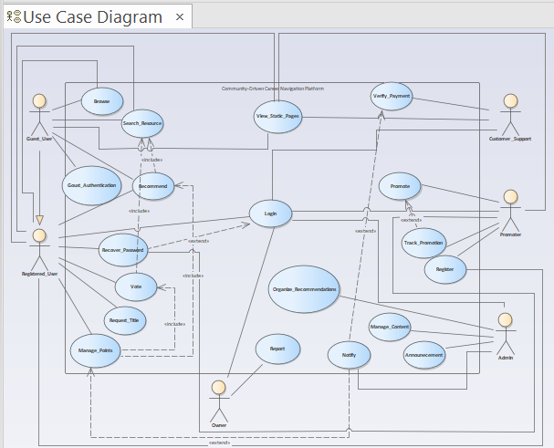

# Wachemo University 
## Department of Software Engineering

## Acknowledgement

## Table of Contents

## Acronym

## Executive Summary

## Chapter One: Introduction
### 1.1 Understanding the Problem Background and Knowing the Exact Problem
#### 1.1.1. Background of the Problem

Choosing a suitable career is an important decision for students, graduates, and job seekers. However, many people face difficulties identifying career paths that match their interests, skills, educational backgrounds, and future goals.

Career information can be scattered across different sources, making it difficult for users to find reliable guidance, understand job market requirements, and learn from people with relevant experience. Traditional career guidance may also be limited in availability, accessibility, or personalization.

A Community-Driven Career Navigation Platform aims to address these challenges by creating a shared digital environment where users can access career information, exchange experiences, receive guidance from community members and professionals, and explore suitable career opportunities.

#### 1.1.2. The Real Environment

The project focuses on the environment in which students, graduates, job seekers, and professionals interact with career information.

- Students need guidance to identify career paths that match their interests and abilities.
- Graduates need information about employment opportunities and the skills required by employers.
- Job seekers need help understanding career options and improving their professional development.
- Professionals and mentors can share their experiences, knowledge, and advice.
- Educational institutions and career advisors can provide relevant career information and guidance.

The platform would provide a common place for these users to communicate, share knowledge, ask questions, and learn from one another.

#### 1.1.3. Root Causes of the Problem

The main causes that may contribute to career navigation difficulties include:

1. Lack of centralized information: Career information is spread across different websites, institutions, and social networks.

2. Limited career guidance: Some students and graduates have limited access to qualified career advisors and mentors. Research on selected schools in Addis Ababa has identified shortages of counselors and other barriers to career guidance.

3. Lack of awareness: Users may not fully understand the range of career paths available to them.

4. Skills and job-market information gaps: Users may struggle to identify the skills, qualifications, and practical experience required for different careers.

5. Limited professional networking: Students and graduates may have difficulty connecting with experienced professionals who can provide practical advice.

6. Lack of personalized guidance: General career information may not adequately consider an individual's interests, abilities, educational background, and goals.

#### 1.1.4. Impact on Target Users

These challenges can affect different users in several ways:

- Students: Difficulty choosing an appropriate field of study or future career.
- Graduates: Difficulty identifying career opportunities and preparing for employment.
- Job seekers: Difficulty understanding job requirements and planning skill development.
- Professionals: Fewer opportunities to share knowledge and mentor people entering their fields.
- Educational institutions: Difficulty providing consistent career guidance and connecting students with relevant professional information.

As a result, users may experience confusion when making career decisions, spend more time searching for information, develop skills that do not match their intended career, or miss relevant opportunities.

#### 1.1.5. The Exact Problem

The exact problem this project aims to solve is the lack of an accessible, centralized, and community-supported system that helps students, graduates, and job seekers discover suitable career paths, obtain reliable career information, connect with experienced professionals, and understand the skills needed to achieve their career goals.

The proposed Community-Driven Career Navigation Platform will address this problem by bringing career resources, community discussions, mentorship, career exploration, and relevant opportunity information together in one digital platform.

### 1.2. Objectives of the project
#### 1.2.1. General objective

To design and develop a web-based, community-driven career navigation platform that facilitates the collaborative curation, ranking, and discovery of high-quality educational resources, while implementing a frictionless lazy-authentication system, a creator point-reward mechanism, and a transparent manual monetization workflow.

#### 1.2.2. Specific objectives

- To Implement Flexible Authentication & Access Control: Develop a secure role-based architecture supporting public registration for creators and promoters, pre-configured staff logins for administrators, support agents, and owners, and on-demand guestTokens for anonymous visitors.

- To Enable Dual-Track Content Discovery & Search: Build dynamic browsing and keyword/URL search features that automatically detect duplicate resource submissions and encourage community voting over redundant entries.

- To Establish Community Participation & Point Systems: Implement a secure voting mechanism (restricted to one vote per user or guestToken) alongside a point accumulation and redemption system that rewards approved creator contributions with free promotions.

- To Support Transparent Monetization & Verification: Provide a structured ad-submission pipeline where promoters can request tiered placements, upload payment screenshots, and track statuses, backed by a manual verification interface for customer support agents.

- To Provide Comprehensive Administration & Reporting: Create a robust management dashboard enabling administrators to moderate content, group duplicate recommendations, manage announcements, and allow the system owner to generate performance and financial analytical reports.

### 1.3. Methodologies
#### 1.3.1. Requirement Elicitation Methodology

To successfully define and build the Community-Driven Career Navigation Platform within a strict 60-day university timeline, a structured, lightweight, and user-centric requirement elicitation methodology is employed. Given the project's academic constraints and defined feature scope, the elicitation process combines four core techniques:

- Document & Project Constraint Analysis: Reviewing academic guidelines, project briefs, and technical boundaries (e.g., manual payment verification, no real-time chat, no automated email dispatching) to establish baseline system constraints.

- Stakeholder & Actor Profiling: Identifying and analyzing distinct system roles—unregistered guests, registered creators, promoters, customer support agents, administrators, and the system owner—to map out precise permissions and dashboard requirements.

- Use-Case & Workflow Modeling: Translating core functional goals into structured use cases and business rules, specifically designing complex workflows like "Lazy Authentication" (on-demand guest tokenization), dual-track recommendations, and duplicate detection.

Iterative Prototyping (Design-First Approach): Utilizing static HTML/CSS layouts and mock data structures as visual prototypes to validate interface flows, ensure team alignment, and refine system logic before full backend (PHP/MySQL) implementation.

#### 1.3.2. Requirement analysis and Modeling

1. Requirement Analysis
The Community-Driven Career Navigation Platform is designed to systematically curate, rank, and recommend educational resources through community participation while balancing frictionless accessibility with strict spam control.
Core Functional Scope (20 Requirements across 5 Subsystems):
- Authentication & Access Control: Supports public registration for Creators and Promoters, pre-configured login for internal staff (Customer Support, Admin, Owner), password recovery, and On-Demand Guest Authentication (guestToken generated strictly when an unauthenticated visitor initiates a vote or recommendation, keeping general browsing stateless).   
- Content Discovery & Interaction: Enables unauthenticated browsing, smart keyword/URL search with duplicate-entry voting prompts, dual-track recommendations (Guest vs. Creator), single-vote enforcement per resource, topic requests, and public static/announcement views.   
- Points & Rewards: Credits reward points to registered creators upon administrative approval of their submissions, unlocking free promotional placement once defined thresholds are reached.   
- Monetization & Support: Facilitates tiered ad requests backed by manual payment screenshot uploads, real-time status tracking, Customer Support verification, and structured support ticketing.   
- Administration & Reporting: Empowers Admins to moderate content, auto-group duplicate URLs with submission counts, and dispatch alerts, while granting the Owner exclusive access to financial and platform analytics.   
Key Business Rules & Constraints:
- Strict single-vote and duplicate-submission prevention tied to either userId or guestToken.   
- Zero financial activation without manual screenshot verification by Customer Support.   
- System constraints exclude automated email dispatchers, real-time chat modules, and payment gateway APIs to ensure reliable delivery within a standard PHP/MySQL stack.

2. System Modeling
The architectural model translates functional needs into clean, modular abstractions ready for Object-Oriented PHP and relational MySQL implementation:
Behavioral Modeling (18 Use Cases & 6 Actors):
- Maps distinct workflows across Guest User, Registered User/Creator, Promoter, Customer Support Agent, Administrator, and System Owner.   
- Enforces separation of concerns: public actors interact with discovery, voting, and promotion flows, while pre-configured administrative actors govern verification, curation, and reporting.
   
Structural Modeling (18-Class Object Hierarchy):
- User Inheritance Hierarchy: An abstract User base class branches into GuestUser (managing on-demand session tokens) and RegisteredUser (handling authentication, voting, and points), which further specializes into Admin, Promoter, CustomerSupport, and Owner.   
- Content Inheritance Hierarchy: An abstract Content base class unifies shared metadata across Resource (categorized, votable learning links) and Announcement (time-bound platform notices).
- Transactional & Operational Classes: Standalone classes—Vote, Recommendation, TitleRequest, Promotion, Payment, SupportTicket, Notification, and StaticPage—decouple business logic and map directly to normalized MySQL tables supporting nullable dual-identity keys (userId and guestToken).

#### 1.3.3. Software Process Model and Management Strategy

For our Community-Driven Career Navigation Platform, we have chosen a Hybrid Agile Software Process Model utilizing Kanban Methodology combined with Phased Milestones. This section outlines why this model was selected and how we will manage our 60-day project lifecycle with a 6-member team.

1. Selection and Justification of the Software Process Model
We selected this hybrid approach after carefully evaluating our team dynamics, technical constraints, and academic goals for the following reasons:
- Handling Variable Team Performance: Our 6-member team has diverse skill levels and paces. Kanban relies on a visual task board (such as GitHub Projects or Trello) where tasks are broken down into granular cards. This allows faster members to pull additional tasks seamlessly while slower or learning members can focus on completing their assigned cards without feeling overwhelmed by rigid, time-boxed deadlines.
- Gradual Technical Learning Curve via Phased Milestones: Since our team members are actively learning PHP and backend development, a strict sequential model would cause bottlenecks. By blending Kanban with structured phases, we can separate tasks logically-focusing initially on frontend layouts before smoothly transitioning into database integration and PHP backend logic as our skills develop.
- Evolving Requirements: Because not all stakeholders or final edge cases are fully known at day one, our flexible workflow gives us the adaptability to continuously add new tasks to the backlog without disrupting the overall project execution.
- Balanced Documentation and Testing: To ensure a high-quality academic report without getting bogged down by heavy enterprise testing overhead, this model keeps our workflow lean and transparent, ensuring that documentation of our architecture and code progresses hand-in-hand with development.

2. Project Management and Execution Strategy
To manage our 60-day timeline effectively, we will execute our hybrid Kanban workflow across three structured operational phases:
Phase 1: Foundation and Frontend (Days 1-10)
 - Focus: UI/UX design, static pages (About, Help, Contact), and foundational HTML, CSS, and JavaScript layouts.
 - Kanban Management: All frontend layout tasks are placed in the backlog and pulled by team members based on availability.
Phase 2: Core Logic and Backend Integration (Days 11-20)
 - Focus: Setting up the MySQL database, implementing user registration, login, session management, and search functionalities using PHP.
 - Kanban Management: Tasks transition from "To Do" to "In Progress" as team members finish learning and testing basic backend scripts on their local Apache servers.
Phase 3: Advanced Features, Polish, and Final Submission (Days 21-30)
  - Focus: Integrating voting, recommendations, point systems, promotions, payment verification, and finalizing the project report.
  - Kanban Management: Strict code reviews and manual testing columns are utilized before moving cards to "Done," ensuring a polished product and complete documentation by day 60.

### 1.4. Scope and Limitation of the Project
#### 1.4.1. Project Scope

The scope of the Community-Driven Career Navigation Platform defines the functional boundaries, core workflows, and technical constraints to be delivered within a 2-month (60-day) timeframe by our 6-member team.

1. In-Scope (What the System Will Do)
 - Authentication & Access Control: Role-based access for 6 actors (Guest, User/Creator, Promoter, Support Agent, Admin, Owner). Guests can browse and recommend, while login/registration is required for creators, promoters, and staff.
 - Content Discovery & Smart Search: Categorized educational resources (YouTube/websites) ranked by community validation. Smart search includes automatic duplicate detection—prompting users to vote if a resource already exists.
 - Recommendations & Voting: Dual recommendation tracks (User and Creator). Creators earn points for valid submissions. Includes custom topic requests (RequestTitle) and grouped admin views displaying total counts (e.g., website.com (3 users)). Users are restricted to a one-time vote per resource.
 - Points & Free Promotions: Users accumulate points via valid recommendations and can redeem them for free promotional placements upon reaching a set threshold (e.g., 20 points).
 - Monetization & Support Workflow: Paid promotion via account transfers, transaction screenshot uploads, and manual verification by Support Agents. Support chat is restricted to troubleshooting promotion status. Promoted products are manually placed on main pages based on payment tiers.
 - Administration & Reporting: Admin content moderation (ManageContent), duplicate organization, and Owner reporting (Report) on revenue and top recommendations.
 - Static Pages & UI Elements: About, Help, Contact pages, main page popup notifications, and featured top-tier resource displays.
 - Deployment & Tech Stack: Local development using standalone Apache, MySQL, and VS Code extensions; deployed to InfinityFree hosting.

2. Out-of-Scope (What the System Will NOT Do)
To ensure delivery within the 60-day schedule, the following features are excluded:
 - Automated Payment Gateways: Third-party payment APIs (Stripe, PayPal, Chapa) are excluded; all payments use manual screenshot and account transfer verification.
 - Advanced AI Recommendations: Complex machine learning recommendation algorithms are excluded in favor of keyword search, voting, and manual curation.
 - Real-Time Live Chat: WebSockets-based live chat is excluded; support messaging is handled via structured database workflows.
 - Automated Email Dispatching: External SMTP server emails are out-of-scope; notifications are handled via internal system alerts.

#### 1.4.2. Limitation

While the Community-Driven Career Navigation Platform is strategically structured to balance academic requirements with functional efficiency, several implementation boundaries and project limitations should be noted:

- Time and Resource Constraints: The platform is developed within a strict 60-day academic timeline by a 6-member student team, requiring an incremental phased development model managed alongside university final exams.

- Manual Processing Limits: To ensure technical manageability within student constraints, payment processing relies on manual transaction screenshot verification by customer support agents rather than an automated third-party payment gateway.

- Communication and Notification Boundaries: The system intentionally omits real-time live chat and external automated email dispatching, utilizing structured ticketing and internal system alerts instead.

- Authentication Scope: Unregistered guest interactions are restricted to on-demand, temporary tokenization exclusively for voting and recommendations, leaving general content browsing entirely stateless.

### 1.5. Domain Vocabulary and Glossary

| No. |     Domain Term       | Definition |
|-----|-----------------------|------------|
| 1   | Learning Topic        | A subject or area of knowledge for which the platform provides educational resources, such as HTML or another learning subject. |
| 2   | Learning Resource     | An educational YouTube channel or website listed on the platform to help users study a particular topic. |
| 3   | Resource Directory    | An organized collection of educational resources made available to users through the platform. |
| 4   | Resource Category     | A classification that groups learning resources according to their subject or area of study. |
| 5   | YouTube Channel       | A YouTube account that provides educational content relevant to one or more learning topics. |
| 6   | Educational Website   | A website that provides educational materials, courses, or learning opportunities. |
| 7   | Topic Request         | A suggestion submitted by a user asking the platform to include an additional learning topic. |

 ### 2. Recommendations and Evaluation

| No. |     Domain Term         | Definition |
|-----|-------------------------|------------|
| 8   | Resource Recommendation | A suggestion submitted to the platform identifying an educational resource that may be suitable for inclusion in its directory. |
| 9   | User Recommendation     | A recommendation submitted through the general recommendation option, which does not require the visitor to register or log in. |
| 10  | Creator Recommendation  | A recommendation submitted through the creator recommendation option by a registered and authenticated user. |
| 11  | Recommendation Count    | The recorded number of times a particular educational resource has been recommended. |
| 12  | Duplicate Recommendation| A recommendation referring to the same educational resource as an existing recommendation. |
| 13  |Recommendation Aggregation| The process of grouping recommendations for the same educational resource while retaining the total recommendation count. |
| 14  | Resource Evaluation     | The manual examination of a recommended educational resource by an administrator before deciding whether to include it in the directory. |
| 15  | Evaluation Criteria     | The standards used by an administrator to assess the suitability and quality of recommended educational resources. |
| 16  | Resource Approval      | The administrator's decision to accept an evaluated educational resource for inclusion in the platform's directory. |
| 17  | Resource Ranking       | The relative position assigned by an administrator to an educational resource within a list. |
| 18  | Recommendation Status  | The current processing condition of a recommendation, such as awaiting review, accepted, or rejected. |

 ### 3. Users and Administration

| No. |     Domain Term       | Definition |
|-----|-----------------------|------------|
| 19  | General Visitor       | A person who accesses the platform to view learning resources and submit general recommendations without being required to register or log in. |
| 20  | Registered Creator    | A registered and authenticated user who can submit creator recommendations and become eligible for contributor points. |
| 21  | Administrator         | An authorized system user responsible for reviewing recommended resources, applying evaluation criteria, determining rankings, and awarding eligible contributor points. |
| 22  | Customer Support Agent| An authorized staff member responsible for manually confirming submitted payments, communicating payment outcomes, and addressing promotion-related complaints. |
| 23  | User Registration     | The process through which a person creates an account to access functions requiring a registered identity. |
| 24  | User Authentication   | The process of verifying a registered user's identity when accessing account-protected functions. |
| 25  | User Account          | A registered identity that allows a user to access functions associated with their assigned role. |
| 26  | User Role             | A classification that identifies a system user's responsibilities and permitted activities. |

### 4. Promotion and Payment

| No. |     Domain Term       | Definition |
|-----|-----------------------|------------|
| 27  | Paid Promotion        | A service through which a person pays to obtain increased visibility or preferred placement for an eligible resource on the platform. |
| 28  | Promotion Request     | A submission requesting additional visibility or preferential placement for a resource through the platform's promotion service. |
| 29  | Promotion Fee         | The amount of money required for a specified promotional service or placement. |
| 30  | Payment Page          | The section of the platform that provides payment information and allows customers to upload evidence of payment. |
| 31  | Payment Evidence      | A screenshot uploaded by a customer to support a claim that the required payment has been transferred. |
| 32  | Payment Verification  | The manual process through which a customer support agent checks and confirms a submitted payment. |
| 33  | Payment Status        | The result or current condition of payment verification, including whether the payment has been confirmed as successful or unsuccessful. |
| 34  | Promoted Resource     | An educational website, YouTube channel, or other eligible resource receiving additional visibility through an approved promotional arrangement. |
| 35  | Promotion Placement  | The position or display location assigned to a promoted resource, including placement influenced by the amount paid. |
| 36  | Promotion Complaint  | A concern or dissatisfaction reported by a customer regarding a promotional service. |
| 37  | Homepage Advertisement | Promotional or announcement content displayed within a designated area or popup on the platform's main pages. |

 ### 5. Contributor Points and Rewards

| No. |     Domain Term       | Definition |
|-----|-----------------------|------------|
| 38  | Contributor Points    | Reward points awarded by an administrator to a registered creator for recommendations accepted as valid. |
| 39  | Point Allocation      | The process through which an administrator assigns contributor points to an eligible registered creator. |
| 40  | Valid Recommendation  | A submitted resource recommendation that has been examined and accepted by an administrator according to the applicable criteria. |
| 41  | Contributor Reward    | A benefit offered to an eligible registered creator in recognition of qualifying recommendations. |
| 42  | Free Promotion Reward | An opportunity for an eligible contributor to receive a promotional service without paying the normal promotion fee. |
| 43  | Contributor           | A registered creator who submits recommendations that may qualify for points and promotional rewards. |

### 6. Platform Information and Support

| No. |     Domain Term       | Definition |
|-----|-----------------------|------------|
| 44  | Featured Resource     | A selected educational resource displayed prominently on the platform, particularly on its main pages. |
| 45  | Homepage              | The platform's main entry page, where visitors can view selected educational resources and promotional content. |
| 46  | About Page            | A page that provides general information about the platform and its purpose. |
| 47  | Help Page             | A page containing guidance and information about how users can obtain assistance while using the platform. |
| 48  | Contact Page          | A page providing ways to contact the platform team and find information about its other websites. |
| 49  | Customer Support      | Assistance provided to customers or users concerning platform services, including promotion-related questions and complaints. |

### 1.6. Development Tools

- Frontend - Html, CSS, and Javascirpt
- Backend  - PHP
- Database - MySQl
- Documention - VS Code

### 1.7. Team Organization

- Minase Megesha   - Project Management & Documentation
- MILLION MERKINE  - Backend Development & API
- Helen Eshetu     - Database Design & Management
- Honelign Tekele  - Frontend Development & UI Testing
- Merihun Meshesha - Integration, Deployment & System Testing
- Bamlak Tadesse   - System Design & Design Modeling
###### Note: 
  Requirement Gathering, Analyis and Aanlyis Modeling is all members task, we don't perform solely.

### 1.8. Project Cost and Resource Estimation

For our Community-Driven Career Navigation Platform, developed as part of our university web programming course, we have structured our cost and resource estimation keeping our academic scope, less than 60-day timeline, and 6-member team in mind.
Since this is an academic student project utilizing professional standalone tools and free deployment tiers, our direct financial expenditure is minimal, primarily covering documentation printing and binding.

1. Direct Out-of-Pocket Expenses (Actual Cost)
- Software & Development Tools: Standalone Apache server, MySQL server, and VS Code with PHP, HTML, CSS, and JavaScript extensions - 0.00 (Free / Open-source)
- Hosting & Deployment: InfinityFree free web hosting tier for online deployment and local testing via our individual local environments - 0.00 (Free)
- Documentation Printing & Binding: Printing final project reports and presentation materials - Minimal (Covering physical printing only)
- Team Communication & Internet: Online coordination and resource research - Covered by personal student packages
- Total Actual Financial Cost: Restricted strictly to physical documentation printing - Minimal

2. Resource Labor Estimation (Commercial Value Perspective)
To maintain a professional software engineering documentation standard, we also look at the resource allocation of our team:
- Team Size: 6 team members.
- Development Duration: 60 days (2 month).
- Development Approach & Infrastructure: Professional modular setup using standalone Apache, MySQL, and VS Code extensions handled collaboratively using an Hybrid Agile Software Process Model utilizing Kanban Methodology combined with Phased Milestones.
- Commercial Equivalent: While our project is executed with a zero-budget infrastructure using free tools and volunteer student labor, a commercial equivalent of this platform would factor in standard developer man-hours and commercial hosting infrastructure fees.
- Summary:
Our project operates on a zero-budget software infrastructure, relying entirely on free, open-source development tools (Standalone Apache, MySQL, and VS Code extensions), free cloud hosting (InfinityFree), and our internal team collaboration, with financial expenses occurring only for final documentation and printing needs.

## Chapter Two: Requirement Analysis and Specifications
### 2.1. Description of the Current System

Currently, learners and users seeking educational and career-related information rely on scattered, ad-hoc web searches, unverified links, and informal recommendations across disconnected websites and video platforms without a centralized, structured directory. This fragmented approach makes discovering reliable learning materials time-consuming and disorganized, leaving users uncertain about whether higher-quality or more relevant resources exist elsewhere and unsure of how to systematically locate better alternatives.

### 2.2. Reusable Components and Existing Solutions
#### 2.2.1. Reusable UI & Functional Components

To keep the interface consistent across pages and reduce repetitive code as the team builds with HTML, CSS, JavaScript, PHP, and MySQL, the following modular components are defined for reuse across RightGuide:

- Registration Form: Enables public users (Content Creators / Registered Users and Promoters) to create accounts with unique email addresses and validated fields.
- Login Form: Enables registered users and pre-configured staff roles (Customer Support Agent, Administrator, and System Owner) to sign in and access their role-specific dashboards.
- Interest Selection: Allows users to choose or filter preferred learning topics and career categories so resource discovery stays relevant.
- Recommendation Cards: Standardized card components (built with shared .rg-* styles) that display recommended websites and YouTube channels, descriptions, category tags, source/access indicators, action links, and vote counts.
- Voting Component: Interactive control that allows guests (via temporary guestToken) and registered users to cast up to one vote per resource and view updated vote totals.
- Recommendation Form: Structured submission form allowing unregistered guests and registered creators to submit new learning resource links (including websites and YouTube channels) with validation and duplicate checks.

#### 2.2.2. Existing Solutions & Browser Capabilities

- Existing solutions and built-in platform capabilities refer to pre-existing tools, APIs, or browser features that provide helpful functionality without building everything from scratch—while still respecting your project's rule against heavy external frameworks:
- YouTube Data API v3 (Optional / Reference Integration): An external service from YouTube that can help search or retrieve metadata for YouTube videos and channels (such as titles, channel details, or descriptions) when curating video resources, provided it fits your scope and API key/quota constraints without introducing external UI frameworks.

Browser localStorage (Vanilla Web Storage API): A built-in browser storage feature accessed via plain JavaScript (localStorage) that stores lightweight client-side data locally in the user's browser—useful during early static/mock UI prototyping or temporary client-side state (such as UI preferences or draft/guest state), while MySQL remains the authoritative database for persisted platform records.

### 2.3. Proposed System
#### 2.3.1. Overview

A community-driven career exploration platform is a structured web-based learning hub designed to systematically collect, rate, and recommend high-quality learning resources through community engagement. It features a frictionless lazy verification method for guests, dual-track recommendations supported by a creative point-reward system, and transparent tiered free promotion processes supported by manual verification workflows. Combining intelligent duplicate detection, robust content moderation and dedicated administrative controls, the platform provides a reliable, secure and user-centric ecosystem for effective career exploration.

#### 2.3.2. Business Rule

- BR-01 — User Registration Rule (FR-01, FR-02): Public users (Content Creators / Registered Users and Promoters) register with unique email addresses and valid credentials, whereas staff roles (Customer Support Agent, Administrator, and System Owner) are pre-configured by the system and do not use public registration.
- BR-02 — User Login & Session Rule (FR-02, FR-03, NFR-03, NFR-10): All registered and pre-configured users must authenticate with valid credentials to access their role-specific dashboard and permitted actions.
- BR-03 — Password Recovery Rule (FR-04): Registered account holders can initiate password recovery through their registered email address without exposing sensitive account data.
- BR-04 — Public Browsing & Static Pages Rule (FR-06, FR-11, NFR-08, NFR-14): Unauthenticated visitors may freely browse curated educational resources and view static informational pages (such as About, Help/Support, and Contact) as well as public announcements/pop-ups.
- BR-05 — Smart Search & Duplicate Prevention Rule (FR-07, FR-17): Searching by keyword or URL encourages users to vote on existing matching entries rather than submitting duplicate resources, while duplicate URL submissions are grouped in the Administrator dashboard with total recommendation counts.
- BR-06 — On-Demand Guest Authentication Rule (FR-05, FR-08, FR-09): A temporary guestToken is generated automatically only when an unregistered guest initiates a vote or recommendation action, preventing repeated spam submissions while keeping general browsing frictionless.
- BR-07 — Single-Vote Enforcement Rule (FR-09, NFR-09): Both guests (via guestToken) and authenticated users are restricted to a maximum of one vote per resource.
- BR-08 — Dual-Track Recommendation Rule (FR-08, FR-12): Both unregistered guests and registered content creators can recommend resource links, but only approved submissions made by registered creators earn reward points.
- BR-09 — Topic Request Rule (FR-10, NFR-12): Registered users can submit requests for new technical learning topics to expand platform categories over time.
- BR-10 — Points Accumulation & 20-Point Promotion Qualification Rule (FR-12, NFR-09): Approved creator recommendations accrue points; a minimum threshold of 20 points is required to qualify for promotional opportunities. Points below 20 cannot be redeemed for promotions.
- BR-11 — Promotion Submission & Payment Methods Rule (FR-12, FR-13, FR-14, NFR-15): Promoters and eligible users (with at least 20 points) may request promotional placements by uploading valid payment transfer screenshots (subject to file type/size validation) or redeeming qualifying points (minimum 20 points). Promoters can track real-time promotion status, and authorized support/admin staff manually verify payment screenshots and update statuses.
- BR-12 — Support & Ticketing Rule (FR-14, FR-15, NFR-04): Users and promoters use structured support channels/ticketing for account, resource, and promotion inquiries without sharing passwords, full card numbers, CVVs/security codes, or one-time verification codes.
- BR-13 — Content Moderation & Ranking Rule (FR-16, FR-17, NFR-18, NFR-09): Administrators review, edit, approve, reject, rank, organize, or remove resource links and manage main-page announcements/featured placements, with key moderation and approval actions logged for accountability.
- BR-14 — Internal Notifications Rule (FR-17, FR-19, NFR-18): The system delivers internal alerts/notifications for content approvals/rejections, point milestones (including reaching the 20-point promotion threshold), topic updates, and promotion/payment verification outcomes.
- BR-15 — System Owner Analytics & Reporting Rule (FR-20, NFR-10, NFR-18): Only the System Owner can access comprehensive analytical reports covering platform revenue, performance metrics, user growth, and top-recommended resources.
- BR-16 — Verification of the Promoter's Source (FR-13, FR-15, FR-16, NFR-04, NFR-15, NFR-16)
Before a promoted placement goes live, the promoted source and accompanying payment proof must pass verification:
    - Sub-points:
        - Promoted Target / Source Check: Verify the destination URL or channel being promoted is reachable, safe, and aligned with educational/career navigation standards.
        - Payment & Point Eligibility Check: Confirm either (a) the uploaded payment screenshot is valid, legible, and matches the required fee/amount, or (b) the user holds at least 20 points for point-based promotion eligibility.
        - Status & Audit Decision: Approve, reject, or mark unsuccessful with clear status tracking and activity records.
        - Key Criteria: Valid non-broken link; safe/appropriate content; accurate payment proof (or $\ge 20$ points); clear file format/size compliance; no sensitive financial credentials exposed.
- BR-17 — Verification of the Source Referred by a User (FR-07, FR-08, FR-12, FR-16, FR-17, NFR-09)
Before a user- or creator-submitted resource is published or rewarded with points, moderators verify the referred source:
    - Sub-points:
        - Uniqueness & Duplicate Check: Check whether the URL or resource already exists or matches a grouped duplicate entry in the moderation queue.
        - Relevance & Quality Check: Confirm the resource provides genuine educational or career-navigation value matching its selected topic/category.
        - Creator Point Eligibility: Award points only if the submission came from a registered creator track, met quality rules, and was approved by an administrator.
        - Key Criteria: Active, accessible URL/channel; no malware, spam, or misleading clickbait; accurate category/topic match; non-duplicate (or properly consolidated).
- BR-18 — Policy Governing Verification of Any Source (FR-06, FR-08, FR-13, FR-16, NFR-09, NFR-14)
All sources—whether organically recommended or submitted for promotion—are governed by a uniform verification policy across every supported source category:
    - Supported Source Categories:
        - Free Educational Sites (open courses, documentation, tutorials, and free learning platforms)
        - Paid Educational Sites (subscription platforms, paid courses, or paid bootcamps—clearly labeled as paid/access-restricted where applicable)
        - Websites Providing Such Content (curated hubs, blogs, portals, or reference sites offering educational or career guidance materials)
        - Free Video-Based YouTube Channels (publicly accessible educational/career YouTube channels without paid membership requirements)
        - Paid Video-Based YouTube Channels (YouTube channels relying on paid memberships, paid courses, or gated video content)
        - Createfite YouTube Channel (verified/official Createfite YouTube channel content, subject to standard accuracy, relevance, and policy checks)
    - Sub-points:
        - Safety, Legality & Accuracy Baseline: Every source must be free of harmful/illegal material, deceptive redirects, or blatantly false instructional claims.- Access & Cost Transparency: Clearly distinguish free vs. paid/subscription resources so learners know what to expect before clicking.
        - Category & Format Alignment: Ensure web vs. video/YouTube sources are tagged accurately and organized cleanly for discovery.
        - Key Criteria: Reachable destination; safe and ethical content; clear free/paid labeling; accurate topic/channel classification; consistent enforcement across all six source categories.

#### 2.3.3. Functional Requirements

1. Authentication & Access Control Subsystem

- FR-01: User Registration
The system shall allow public users (Registered User/Content Creator and Promoter) to create accounts.

- FR-02: Pre-configured Staff & Administrative Access
The system shall provide secure system access for pre-configured administrative roles (Customer Support Agent, Administrator, and System Owner) through direct authentication (Login) without requiring public registration.

- FR-03: System User Authentication
The system shall authenticate registered actors (Registered User, Promoter, Customer Support Agent, Administrator, and System Owner) using secure session management and password verification (Login).

- FR-04: Password Recovery
The system shall allow registered account holders to recover access to their accounts via password reset (RecoverPassword).

- FR-05: On-Demand Guest Authentication
The system shall automatically generate a temporary guestToken (Guest_Authentication) only when an unregistered guest initiates a Vote or Recommend action, preventing multiple submissions while keeping general browsing unauthenticated.

2. Content Discovery & Interaction Subsystem

- FR-06: Dynamic Resource Browsing
The system shall allow Guest Users and Registered Users to browse curated lists of educational resources (Browse).

- FR-07: Smart Resource Search
The system shall allow users to search for educational resources by keywords or links (SearchResource) and prompt users to vote on existing entries to prevent duplicates.

- FR-08: Resource Recommendation
The system shall allow unregistered guests (via Guest_Authentication) and registered content creators to submit new resource links (Recommend).

- FR-09: Community Voting
The system shall allow guests and registered users to vote on resources (Vote), enforcing a maximum of one vote per resource per user or guestToken.

- FR-10: Topic Request Submission
The system shall allow registered users to submit requests for new technical learning topics (Request_Title).

- FR-11: Static Page Navigation
The system shall display informational pages including About, Help, and Contact (View_Static_Pages) to all platform visitors.

3. Points & Reward Subsystem

- FR-12: Points Management & Rewards
The system shall calculate, award, and manage reward points (Manage_Points) for registered creators upon approval of their recommendations, unlocking options for free promotion redemption.

4. Monetization & Support Subsystem

- FR-13: Paid Promotion Submission
The system shall allow promoters to submit ad placement requests and upload payment transfer screenshots (Promote).

- FR-14: Promotion Tracking
The system shall allow promoters to track the real-time review status of their ad submissions (Track_Promotion).

- FR-15: Manual Payment Verification
The system shall allow Customer Support Agents to inspect payment screenshots and verify transactions (Verify_Payment).

5. Administration, Moderation & Reporting Subsystem

- FR-16: Content Moderation
The system shall allow Administrators to review, edit, approve, reject, rank, or delete submitted resource links (Manage_Content).

- FR-17: Recommendation Organization
The system shall group duplicate URL submissions in the Admin dashboard and display total user recommendation counts (Organize_Recommendations).

- FR-18: Announcement Management
The system shall allow Administrators to publish and manage popup announcements and featured promotions on main pages (Announcement).

- FR-19: System Notifications
The system shall dispatch internal alerts and updates (Notify) regarding payment approvals, content status, or account actions.

- FR-20: System Owner Reporting
The system shall provide the System Owner with analytical reports summarizing platform revenue, performance metrics, user growth, and top recommendations (Report).

#### 2.3.4. Non-Functional Requirements

1. Performance: The system should load pages within 3 seconds under normal usage and display search results within 5 seconds.

2. Usability: The system should provide a simple and user-friendly interface so users can easily browse, search, vote, and recommend educational resources.

3. Security: The system should protect user accounts by storing passwords in encrypted/hashed form and preventing unauthorized access.

4. Privacy: The system should protect users' personal information, payment details, and uploaded payment screenshots from unauthorized users.

5. Reliability: The system should process user requests correctly and display clear success or failure messages.

6. Availability: The system should be accessible whenever the hosting server is operating and should display an appropriate message during service interruptions.

7. Compatibility: The system should work properly on commonly used browsers such as Google Chrome, Firefox, and Microsoft Edge.

8. Responsiveness: The system should adjust its layout to work properly on desktop computers, tablets, and mobile phones.

9. Data Integrity: The system should maintain accurate information about educational resources, votes, reviews, rankings, and reward points.

10. Access Control: The system should provide different access permissions for normal users, administrators, and customer support agents.

11. Maintainability: The system should be organized into manageable modules so developers can easily fix errors and update system features.

12. Scalability: The system should allow additional users, learning topics, educational resources, and recommendations as the platform grows.

13. Backup and Recovery: The system should support regular database backups and allow stored information to be restored when data is lost.

14. Accessibility: The system should use readable fonts, appropriate color contrast, clear labels, and easy navigation.

15. File Upload Validation: The system should validate uploaded payment screenshots by checking their file formats and file sizes.

16. Payment Verification Security: Only authorized administrators or support agents should be allowed to verify payments and update payment statuses.

17. Notification Reliability: The system should correctly display announcements and notifications when new topics, payment updates, or promotion updates occur.

18. Activity Tracking: The system should maintain records of important administrative activities, including content management, payment verification, and promotion approval.

#### 2.3.5. Actor and Use case Identification

1. Actor Identification
- Guest User: An unregistered visitor who can freely browse and search the platform; the system automatically generates a temporary guestToken only when they initiate a vote or resource recommendation.

- Registered User / Content Creator: An authenticated user who can register, log in, vote, submit resource recommendations, request new topics, and accumulate reward points.

- Promoter: An authenticated user who submits paid promotion requests and uploads transaction confirmation screenshots.

- Customer Support Agent: A pre-configured staff member who logs in to inspect uploaded payment screenshots and manually verify transactions.

- Administrator: A pre-configured staff member responsible for moderating content, organizing recommendations, managing announcements, and dispatching notifications.

- System Owner: A high-level stakeholder who logs in exclusively to view analytical reports covering platform revenue, user growth, and performance metrics.

2. Use Case Identification
Authentication & Access Subsystem:

- Register: Allows public users and promoters to create new accounts.
- Login: Authenticates registered users, promoters, and pre-configured staff roles.
- Recover Password: Enables account recovery via email verification.
- Guest Authentication: Automatically assigns a temporary token on-demand to prevent spam during guest voting and recommendations.

Content Discovery & Interaction Subsystem:

- Browse: Public exploration of categorized educational resources.
- Search Resource: Keyword and link-based lookup with duplicate-prevention prompts.
- Recommend: Dual-track submission of new learning links by guests and registered creators.
- Vote: Community voting restricted to one vote per user or guestToken per resource.
- Request Title: Submission of user suggestions for new learning topics.
- View Static Pages: Access to informational pages (About, Help, Contact) and announcement popups.

Monetization & Support Subsystem:

- Promote: Submission of ad placement requests and payment screenshots.
- Track Promotion: Real-time monitoring of promotion request statuses.
- Verify Payment: Manual inspection and approval of payment proof by support agents.

Administration & Reporting Subsystem:

- Manage Content: Review, editing, approval, and deletion of submitted educational links.
- Organize Recommendations: Automated grouping of identical URLs with total user recommendation counts.
- Manage Points: Calculation and tracking of reward points for verified creator contributions.
- Notify: Internal alert generation for account and transaction updates.
- Announcement: Publishing of platform-wide popup announcements and featured promotions.
- Report: Generation of comprehensive financial and performance analytics for the system owner.

#### 2.3.6. System Model
##### 2.3.6.1. Use case Model

##### 2.3.6.2. Activity Diagrams

##### 2.3.6.3. Class Diagram

## Chapter Three: Database Design
### 3.1. Conceptual Database Design of the New System 
#### 3.1.1. Entities identification and Description 

#### 3.1.2. Attributes identification and description 

#### 3.1.3. Relationship identification and description 

#### 3.1.4. ER Diagrams

### 3.2. Logical Database Design of the New System 
#### 3.2.1. ER to Table Mapping 

#### 3.2.2. Validate Model using Normalization  
##### 3.2.2.1. First Normal Form (1NF)  

##### 3.2.2.2. Second Normal Form (2NF) 

##### 3.2.2.3. Third Normal form (3NF)  

#### 3.2.3. Relational Schema with Referential Integrity after normalization 

 

## Chapter Four: System Design
### 4.1. Introduction

### 4.2. Software Architecture

#### 4.2.1. Subsystem Decomposition

#### 4.2.2. Component Diagram 

### 4.3. Design, Engineering, and Execution Standards
#### 4.3.1. Visual Design Tokens and UI Components
##### Visual Design Tokens

Visual Design Tokens are named, reusable design choices—such as colors, font sizes, spacing steps, corner roundness, and subtle shadows—that define how RightGuide looks and feels. Instead of typing raw values like #1E3A8A or 16px repeatedly across different pages and stylesheets, the team gives each choice a clear, meaningful name (a token). When a token is updated in one central place, every screen that references it stays visually aligned.

- Why They Matter for RightGuide: With multiple team members building pages and features across HTML, CSS, JavaScript, PHP, and MySQL, tokens prevent visual drift and make global adjustments fast and predictable.

- Practical Working Model: Start with a small, essential set of tokens in a shared stylesheet layer (colors, typography scale, spacing increments, and border/status styles) so static pages, mock data views, and later dynamic templates all draw from the same single source of truth.

##### UI Components

UI Components are self-contained, reusable building blocks of the user interface—such as navigation bars, resource cards, vote controls, forms, badges, modals, and dashboard panels—assembled from visual design tokens and semantic structure. Rather than crafting each screen from scratch, team members assemble pages out of proven components that share predictable behavior and appearance.

- Why They Matter for RightGuide: Reusable components keep learning resource listings, recommendation and voting interactions, promotion and payment verification views, and role-based dashboards consistent while reducing duplicate markup and styling effort.

- Practical Working Model: Build clean, modular component patterns during static HTML/CSS work with consistent class names and clear states (default, hover/active, disabled, and feedback/status states). That way, when JavaScript, PHP, and MySQL are wired in later, dynamic data drops right into existing components without rewriting the interface.

#### 4.3.2. Page Structure and Layout Conventions

Page structure and layout conventions define how every screen on RightGuide is organized from top to bottom so users always know where to look, and teammates can build distinct pages without inventing conflicting layouts.

1. Standard Document & Page Skeleton
- Every page across RightGuide follows a predictable semantic hierarchy so assistive tools, CSS rules, and future PHP/JavaScript templates behave consistently:

- Top Navigation Bar (.rg-navbar): Sticky top bar containing the RightGuide brand link, primary navigation links, and account/role entry controls.

- Page Header / Context Band: Concise page title (<h1>), one-sentence purpose summary, and optional status badge or back/action link.

- Main Content Region (<main>): Houses the primary page workflow (resource directory, search/filter controls, recommendation/promotion forms, or role dashboard).

- Footer (.rg-footer): Contains platform copyright, key static/policy links (Terms, Privacy, Contact, Support), and a return link to the main hub.

2. Layout Modes by Page Type
Rather than forcing every screen into a single mold, RightGuide uses three clear layout patterns:

- Discovery & Feed Layout (Home / Browse / Search):

  - Top navigation + search/filter bar + optional duplicate-match prompt banner.

  - Responsive card grid (1 column on small screens, 2 columns on tablets, 3 columns on desktop) for learning websites and YouTube channels, with featured/promoted cards clearly distinguished.

- Task & Form Layout (Recommend / Request Topic / Promote / Auth):

  - Focused single-column container (max-width: 680px–760px) centered in the viewport to minimize distractions during data entry, duplicate checks, or payment screenshot uploads.

- Role Dashboard Layout (Creator, Promoter, Support, Admin, Owner):

  - Clear summary metrics or internal notification/ticket/moderation queues paired with structured tables or card lists and status badges (Pending, Approved, Unsuccessful)—using internal dashboard views rather than external email or live chat.

3. Container Width, Grid & Responsive Rules
Max Content Width: Constrain main content wrappers to --container-max (1200px) with horizontal side padding (--space-4 on mobile, --space-6 on wider screens) so lines and cards remain easy to scan.

Spacing Rhythm: Separate major page sections with consistent vertical gaps (--space-6 to --space-8) and internal card/form spacing using --space-3 and --space-4.

Responsive Breakpoints: Design mobile-first so navigation wraps or stacks cleanly on narrow screens and grids expand smoothly on tablet (≥ 768px) and desktop (≥ 1024px) viewports without horizontal overflow.

Lightweight & Scannable: Keep page sections clean, avoid heavy visual clutter, and keep layouts straightforward so pages load fast and stay easy to maintain as JavaScript, PHP, and MySQL are layered in.

4. Handoff Rules for Static-to-Dynamic Transition
Keep Layout Wrappers Stable: Teammates building static HTML/CSS should name layout containers clearly (for example, layout-pages.css for page-level grids and shells) while keeping .rg-* components from tokens.css untouched.

Design for Dynamic Injection: Leave clean parent containers (such as a card grid wrapper or list body) where JavaScript mock data or PHP loops can render items without changing outer page structure.

Guard Relative Paths: Keep folder names clean and consistent across subdirectories (such as pages/static-pages/, pages/authentication-pages/, pages/resources-pages/, and pages/controller-pages/) so relative asset and page links do not break when files move or when PHP includes are introduced.

#### 4.3.3. Language, Terminology, and Label Standards

Clear, consistent language keeps RightGuide easy to read for users and prevents confusion among team members writing HTML, JavaScript, PHP, and MySQL. When multiple people build different pages and workflows under a tight timeline, inconsistent wording—such as calling the same status Pending on one page and In Review on another—creates unnecessary bugs and rework.

1. Primary Language and Tone
- Primary Interface Language: Standardize the UI, labels, messages, and documentation in clear, plain English (lang="en"), keeping localization out of the current scope unless future expansion justifies it.
- Tone and Clarity: Use direct, supportive, and easy-to-scan wording. Keep instructions concise, avoid jargon in user-facing text, and state security boundaries clearly (such as never asking users to share passwords or sensitive financial details).

2. Standardized Terminology Across Code and Docs
- Platform & Content Terms: Refer to the system consistently as RightGuide (full name: Community-Driven Career Navigation Platform), and refer to curated items consistently as career resources or learning resources (covering websites and YouTube channels).
- Roles & Access Terms: Use exact, consistent names for user roles and access states across UI labels, documentation, and code—such as Guest (including temporary guest token actions), Registered User, Creator, Promoter, Support, Admin, and Owner.
- Workflow & System Terms: Keep workflow labels aligned with system behavior—such as internal notifications (dashboard alerts rather than external automated emails) and support tickets / inquiries (asynchronous requests rather than live chat).

3. Status Badges, Buttons, and Navigation Labels
- Standardized Status Terms: Use uniform status labels across badges, tables, and dashboards—such as Pending, Approved, and Unsuccessful (or Rejected where already defined in your rules)—paired with matching semantic badge classes (.rg-badge--warning, .rg-badge--success, .rg-badge--danger, .rg-badge--info).
- Action & Navigation Labels: Keep button and link labels action-oriented and consistent across pages (for example, Browse, Recommend, Promotions, Support, Sign In, Vote, and Submit).
- Capitalization & Formatting: Use Sentence case for headings, labels, alerts, and buttons (e.g., Frequently asked questions, Contact support, Return to RightGuide home) rather than mixing random title casing and all-caps across screens.

4. Practical Rules for the Team
- Match UI Labels to Data Values: Keep display text and underlying status/category values predictable so JavaScript and PHP templates do not need awkward translation maps.
- Check Copy Before Merging: During page reviews, verify that new buttons, badges, and headings use existing RightGuide terms instead of inventing synonyms.

#### 4.3.4. Shared Data Schema, Naming Conventions, and Access Permissions

Agreeing on a shared data structure, naming rules, and permission boundaries before full parallel development prevents mismatched fields, broken links, and unauthorized actions across RightGuide. When multiple teammates build frontend views, JavaScript mock logic, PHP endpoints, and MySQL tables under a tight timeline, consistency in these three areas keeps integration predictable.   

1. Shared Data Model & Schema Alignment
- Core Entities & Identifiers: Align entity and field names across documentation, mock data, and MySQL tables—such as users/roles, career resources (websites and YouTube channels), votes, recommendations/topic requests, promotions/payment proofs, internal notifications, and support tickets—using clear primary and foreign keys.
- Guest Token & State Tracking: Clearly separate passive browsing from token-based guest actions (such as temporary guest tokens used for voting or recommending without forcing full registration) and record explicit workflow states (such as Pending, Approved, and Unsuccessful) rather than leaving statuses implicit.
- Duplicate Handling & Validation: Define unique identifiers or normalization checks (such as matching URLs or normalized titles) and enforce server-side validation so duplicate resources or incomplete submissions are caught cleanly.

2. Naming Conventions Across Code and Files
- Files & Folders: Use lowercase kebab-case for files and folders (for example, tokens.css, layout-pages.css, support.html, and static-pages/), and keep directory names free of typos so relative paths stay reliable.
- CSS & Markup: Keep shared design-token variables and reusable component classes prefixed cleanly (such as --color-*, --space-*, and .rg-*), and use data-* attributes or dedicated JS hooks rather than tying JavaScript logic directly to visual layout classes.
- Database, PHP & JS Identifiers: Use consistent, descriptive names (snake_case for MySQL columns/tables and consistent field names across JSON/JS/PHP payloads) so the same concept is never named three different ways across layers.

3. Role-Based Access Permissions & Auditability
- Least-Privilege Access: Explicitly define what each role—Guest, Registered User, Creator, Promoter, Support, Admin, and Owner—can view, create, update, or approve, and enforce authorization checks on the server rather than relying only on hiding UI buttons.
- Scope-Aligned Workflows: Keep permissions aligned with project rules—such as internal dashboard notifications (rather than external automated email), asynchronous support tickets (rather than live chat), and manual payment screenshot verification by authorized staff.
- Basic Auditability: Track key state changes—such as who approved or rejected a promotion, ticket, or resource, and when—so reviews and accountability remain clear without overcomplicating the system.

#### 4.3.5. Delivery Sequence, MVP Scope, and Quality Assurance Rules

A clear delivery sequence, bounded MVP scope, and practical quality assurance rules keep the RightGuide team focused on shipping a reliable, cohesive platform on schedule. Working incrementally—building static HTML/CSS pages first before layering in JavaScript, PHP, and MySQL—reduces integration risk and keeps everyone aligned across both documentation and code.

1. Staged Delivery Sequence
- Stage 1 — Static UI & Shared Styling: Build core pages and shared stylesheets (tokens.css and layout-pages.css) using .rg-* components and mobile-first responsive layouts.
- Stage 2 — Mock Interactivity & Screen Flows: Layer in client-side mock data and interactive UI behaviors (such as search/filter views, voting/recommendation flows, duplicate prompts, and role dashboard layouts) while keeping markup and class names stable.
- Stage 3 — Backend Integration (PHP & MySQL): Connect forms, authentication/role workflows, promotion/payment proof uploads, internal notifications, and support tickets to PHP endpoints and the MySQL schema defined in 1.10.4.
- Stage 4 — End-to-End Verification & Polish: Consolidate fixes, verify cross-page navigation and permissions, and finalize documentation alignment ahead of deadlines.

2. MVP Scope Discipline
- Prioritize Core Value First: Focus MVP effort on browsing and discovering career resources (websites and YouTube channels), core voting/recommendation and topic-request workflows, essential authentication/role views, and core promotion/support flows.
- Guard Against Scope Creep: Defer non-essential enhancements or extra visual polish until core flows work end-to-end, and keep interactions aligned with project rules (such as internal notifications rather than external email automation, and asynchronous support requests rather than live chat).
- Maintain Single-Source Consistency: Ensure new screens or adjustments update tokens.css, layout-pages.css, terminology, and data/permission rules together rather than introducing one-off exceptions.

3. Quality Assurance & Testing Rules
- Visual & Responsive Checks: Verify pages across mobile, tablet, and desktop widths for layout alignment, readable contrast, working relative paths (../../css/, ../...), and consistent .rg-* component styling.
- Functional & Role Boundary Checks: Test form validation, duplicate resource checks, guest token vs. authenticated role actions, status transitions (Pending, Approved, Unsuccessful), and server-side permission enforcement.
- Pre-Merge Review Checklist: Confirm clean folder/file naming (kebab-case, no typos), no hardcoded style values bypassing design tokens, and clear error/empty states before merging changes into the shared repository.

### 4.4. Backend Route / Endpoint & Folder Map

Note: list of PHP files/endpoints and parameters

### 4.5. Security & Input Validation Rules

Note: validation, prepared statements, output escaping, upload checks

### 4.6. Traceability Matrix
#### 4.6.1. Role-Based Access Matrix

A Traceability Matrix is a tracking table that connects every system requirement directly to its corresponding UI page, backend PHP endpoint, MySQL table, and test case so nothing is forgotten or left untested during development.
Example: 
- Req ID	Feature / Requirement	Use Case / Rule	Frontend Page	Backend Endpoint (PHP)	Database Table(s)	Test ID & Status
- FR-01	Browse & filter career resources	UC-01, BR-01	index.html	/backend/actions/fetch_resources.php	resources, categories	TC-01 (Planned)

- Quick Guide for Your Team
Req ID & Feature: Identifies what we are building (matching 2.3.3 Functional Requirements).
Use Case / Rule: Points to the exact behavior and validation rules (2.3.2 & 2.3.6.1).
Frontend Page: Tells UI developers where the screen lives (frontend/...).
Backend Endpoint (PHP): Tells backend developers which PHP file processes the request (backend/...).
Database Table(s): Shows which MySQL tables are read or updated (Chapter 3).
Test ID & Status: Confirms how and when the feature is verified before final submission (Chapter 5).

## Chapter Five: Implementation and Testing 
### 5.1. Test Procedure

### 5.2. User Manual Preparation

## Chapter Six: Conclusion and Recommendation 
### 6.1. Conclusion 

### 6.2. Recommendation

